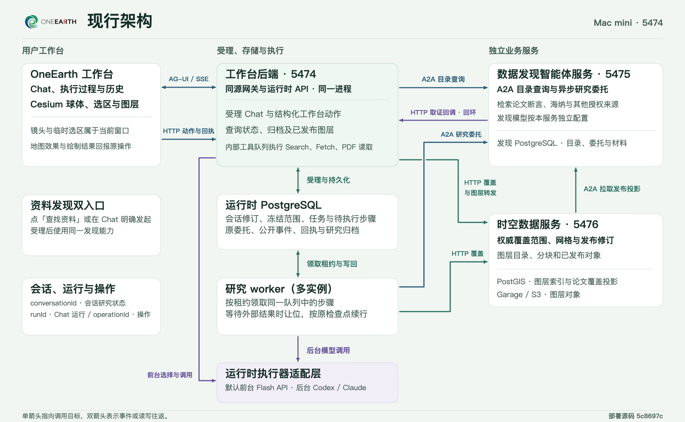

# OneEarth

<picture>
  <source media="(prefers-color-scheme: dark)" srcset="public/brand/OneEarth-lockup-dark-transparent@1x.png">
  
</picture>

让地球可被理解和计算。

OneEarth 用于提出研究问题、核对数据和文献依据，以及在球体上查看数据的空间范围与时相。

## 当前工作台

Mac mini 常驻 5474 运行提交 `5c8697c`，设置页显示 `v0.2.0-rc.11`。GitHub 的 `v0.2.0-rc.12` 预发布基于同一应用源码。工作台支持本机与获准的局域网访问。案例页提供四张使用统一球体缩略图尺寸的可视化卡片，科学问题案例区保持空白。[现状与访问范围](docs/架构与接口现状.md) · [最新正式验收](evidence/product/ACCEPTANCE.md#mac-mini-工作台资料发现与归档授权正式发布) · [GitHub 预发布](https://github.com/lust0yixiong/OneEarth/releases/tag/v0.2.0-rc.12)

工作台与运行时 API 共用同源入口。Chat 以 AG-UI 1.0 提交运行并接收 SSE，断流后按原运行编号读取状态和归档。默认模型为 DeepSeek Flash。需要推理摘要时，可在设置中选择 Codex 原有服务下标有「思考摘要」的 `gpt-6.1-sol`。研究 worker 支持多实例，从同一队列按租约领取。工作台「查找资料」与 Chat 明确发起的资料发现共用运行时受理。[浏览器接口](docs/工作台-AG-UI.md) · [现行进程拓扑](docs/架构与接口现状.md#现行进程拓扑)

主图按 5474 的已部署链路绘制。Chat 和 Cesium 球体共用工作台和同源后端。运行时将会话研究状态、任务和持久操作写入 PostgreSQL，多个 worker 按租约领取步骤。[主图连线说明](docs/架构与接口现状.md#主图连线说明) · [规划图及其他版本](docs/diagrams/README.md)

## 从这里开始

| 读者需要 | 入口 |
| --- | --- |
| 本机部署、独立复跑、备份或恢复 | [部署与恢复手册](docs/部署与恢复.md) |
| 当前服务职责、接口和未实现的约束 | [架构与接口现状](docs/架构与接口现状.md) |
| 工作台提交、SSE 事件、断流与错误示例 | [工作台 AG-UI 契约](docs/工作台-AG-UI.md) |
| 覆盖修订、网格查询及图层分块 | [时空数据服务契约](docs/时空数据服务-接口.md) |
| 前台、研究 worker 与执行器的内部交接 | [运行时与执行器契约](docs/运行时与执行器-接口.md) |
| 运行时、发现与工具调用的请求、回执和兼容规则 | [发现服务 A2A 契约](docs/发现服务-A2A.md) |
| 开始开发、送审文档或准备发布 | [开发协作规范](CONTRIBUTING.md) |
| 查验版本、对照实测或了解测试边界 | [产品验收记录](evidence/product/ACCEPTANCE.md) |

## Mac mini 部署

开发和复跑使用独立目录、独立数据库与对象存储，以及空闲端口。完整的输入清单、构建、种子导入和启动命令见[首次隔离部署](docs/部署与恢复.md#首次隔离部署)。

### Mac mini 常驻入口

常驻应用和存储由 `launchd` 管理。发布目录、启动与切换边界见[常驻运行与发布](docs/部署与恢复.md#常驻运行与发布)。

## 服务与数据

同源入口在工作台后端直接处理运行时业务路由。发现服务规划找取资料，运行时经适配层执行获准的公开 Search、Fetch，时空服务负责覆盖范围和已发布图层。[现行接口索引](docs/架构与接口现状.md#现行接口索引)

## 备份和恢复

产品备份保存三个产品库与图层对象。应用状态和获准原件另行保存。复跑使用独立存储及 5574–5576 三个应用端口。[备份、恢复与兼容迁移](docs/部署与恢复.md#备份和恢复)

## 目标与历史

[目标与架构](docs/spec/01-目标与架构.md)、[两阶段工程交付](docs/spec/02-工程交付.md)和[验收口径](docs/spec/03-验收与证据.md)保存重构目标与验收基线。历史开发版本为 `v0.1.0`，存储与恢复基线为 `v0.2.0-dev.1`。[历史验收记录](evidence/ACCEPTANCE.md) · [品牌素材说明](public/brand/README.md)
