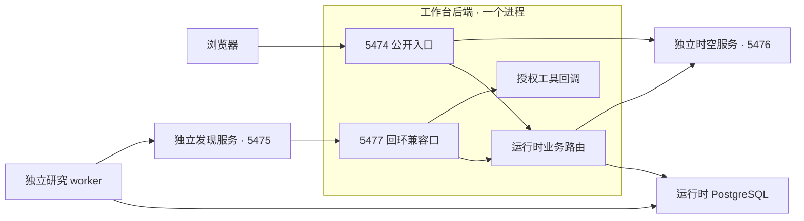

<a id="oneearth-架构与接口审查"></a>

# OneEarth 架构与接口现状

Mac mini 自 2026-11-24 08:30:53（上海时间）运行 **v0.2.0-rc.10**，发布提交 `521a01e`，产品源码合流点 `b550008`，发布目录为 `~/Library/Application Support/OneEarth Next/releases/v0.2.0-rc.10-521a01e`。本版启用球面数据速览的「数据上球」、人工追问弹框和前台单决定协议。5474 和 5477 由同一进程监听。5474 支持本机回环及指定局域网，经直连网段、Host 与同源 Origin 校验。5475、5476、5477、55432、5900 继续使用本机回环。设置页显示当前版本，具体发布由源码和构建指纹区分。[本轮正式验收](../evidence/product/ACCEPTANCE.md#mac-mini-数据上球与前台追问正式发布) · [工作台后端合并正式验收](../evidence/product/ACCEPTANCE.md#mac-mini-工作台后端合并正式发布) · [前台 Chat 正式验收](../evidence/product/ACCEPTANCE.md#mac-mini-chat-前台消息与研究交接正式发布) · [rc.10 首发验收](../evidence/product/ACCEPTANCE.md#mac-mini-rc10-公开网络工具与局域网正式发布)

数据触达主导航默认隐藏，可在设置中启用。目录提供分类浏览与已有链接，资料查找可用 Chat。案例页保留四张可视化卡，科学问题区仅有标题。森林与 C40 可从海纳数据集详情上球，降水可选年月取自本部署发布目录。Chat 通过已匹配的来源卡附加已登记的观测文件版本，可直接读取原始 NetCDF。下文保留各阶段的验收口径。[发现渠道范围上线](../evidence/product/ACCEPTANCE.md#mac-mini-发现渠道范围正式发布) · [数据触达发布](../evidence/product/ACCEPTANCE.md#mac-mini-数据触达浏览入口静态发布) · [目录架构梳理](#数据触达现行架构梳理) · [观测资料发布](../evidence/product/ACCEPTANCE.md#mac-mini-chat-观测资料入口静态发布) · [KEO 常驻切换](../evidence/product/ACCEPTANCE.md#mac-mini-日常入口的-keo-文件读取)

## 公开逻辑架构

[README 横版主图](diagrams/oneearth-public-architecture.png)展示 rc.10 形成的逻辑分工。图中网关与运行时 API 两框对应现行工作台后端同一进程内的模块。图中另预留了与数据发现并列的数据处理智能体服务，拟由运行时通过 A2A 委托并接收结果。

## 现行进程拓扑



5474 的 Chat、任务、目录、结果和覆盖等路由在工作台后端直接处理，普通请求无需连接 5477。发现服务仍以回环 5477 调用获准的网页工具，旧客户端也可从此口访问原运行时 API。两个入口各保留原健康响应与访问校验。网页登录模型设置的临时凭据及测试执行名额与产品运行时保持隔离。两个监听共享工作台后端的进程故障域，研究 worker、发现、时空及三库的原职责继续独立。[工作台入口](../server/index.ts) · [运行时路由与资源](../server/runtime-api-service.ts) · [启动与兼容模式](部署与恢复.md#端口)

## rc.10 图注

[横版架构实况](diagrams/oneearth-mac-mini-rc10.png)记录 rc.10 首发快照。此后启用的前台消息与研究交接见下文。公开逻辑图、目标设计和各发布快照可在[图索引](diagrams/README.md)分别查看。

- **任务提交与领取。** 现行工作台公开入口在进程内处理运行时业务，先写入运行时 PostgreSQL。普通 Chat 完成前台决定，需要研究时按原消息编号持久交接。独立 worker 从同库按事务领取可执行的研究任务或已到期的续行步骤，再写入结果和事件。首发图中运行时 API 指向 worker 的箭头表示持久化交接。[任务提交与领取实现](../server/postgres-task-store.ts)
- **研究取证与浏览预览。** 研究中的定向补读与开放查找仍经发现 A2A。发现决定读取范围，运行时适配层实际执行获准的公开读取并归档可追溯证据。浏览器显式打开来源、查看已保存依据或调用同源预览各走展示路径。将网页材料纳入研究证据须经带回执的研究取证。地图发布资源经网关转给时空服务，覆盖范围的业务查询经运行时 API 转给时空服务。[发现契约](发现服务-A2A.md#指定来源补读) · [预览路由](../server/source-preview.ts) · [网关](../server/index.ts)

## 现行接口索引

| 消费者 → 提供者 | 入口及归属 |
| --- | --- |
| 工作台 → 同源后端的运行时路由 | 5474 直接挂载普通 Chat `POST /api/chat/messages`、旧研究提交及 `/api/tasks` 状态、取消、归档和 NDJSON 事件接口。结果快照、数据触达、论文详情、海纳目录、获准观测材料及覆盖查询也在同进程接入。5477 提供相同业务的本机兼容入口。[运行时路由](../server/runtime-api-service.ts) · [任务事件路由](../server/task-store.ts) |
| 运行时 → 发现服务 A2A | 回环 5475 上的 `POST /message:send` 是现行委托入口。论文、论文时空投影、海纳目录和指定逐景查询返回直接 Message。开放发现和精确补读受理为 Task，从原 Task 读取、订阅或取消。旧 `/v1/discoveries` 保留兼容。[请求、回执与兼容契约](发现服务-A2A.md) |
| 发现服务 → 运行时内部工具入口 | 回环 5477 上的 `POST /internal/discovery-web-tool/v1` 使用原 Task、消息、调用 ID 和本轮授权。运行时执行工具并保存回执，发现决定如何采纳。[工具契约](发现服务-A2A.md#公开网络工具的运行时执行) |
| 运行时 → 时空服务 | 回环 5476 签发权威覆盖范围和修订，负责覆盖及图层索引。工作台的覆盖与图层目录请求先经运行时。已发布降水清单、瓦片及指定海纳图像由网关转给时空服务。[覆盖路由](../server/coverage-router.ts) · [时空入口](../server/spatial-service.ts) |
| 同源网关的展示能力 | 静态页面、基础网格、用户主动打开的来源预览和模型设置有各自的路径。普通 Chat 的观测材料卡匹配已保存来源，并经运行时获取已登记身份。[入口路由](../server/index.ts) · [观测材料契约](发现服务-A2A.md#普通-chat-的观测资料) |
| 持久状态与发布 | 运行时、发现、时空各持有本域 PostgreSQL 数据。论文发布在发现库，时空消费 A2A 版本化投影并存入 PostGIS。图层对象由时空使用 S3。外部论文断言库保持只读。[论文发布与时空投影](#mac-mini-论文发布与时空投影) · [备份与恢复](部署与恢复.md#备份和恢复) |

网页侧任务事件由运行时提供 NDJSON，运行时与发现服务之间的 Task 订阅使用 A2A SSE。首问、状态读取、重开归档或读已发布目录各有不同的授权与执行路径。

## 普通 Chat 的发问时工作台状态

本节对应 Mac mini 常驻工作台。发问时由网页从当前渲染器和工作台控件取得可见状态，冻结到同一个任务请求的可选 `context.workspaceView`。它与对话历史、同一轮的显式附件、发现任务和研究归档分开。旧客户端可以省略该字段。

| 部分 | 职责 |
| --- | --- |
| 网页工作台 | 提交有界状态，包括当前页面、真实相机、可见网格与筛选、活动图层的当前选项和可用控件、短图例或计数、当前打开的详情或依据位置。相机中心、选中网格和显式附加范围分别记录。资料正文、文件地址和整批候选留在既有路径。[快照形状](../src/domain/workspace-view-context.ts) · [网页投影](../src/domain/workspace-view-projection.ts) |
| 运行时 | 让原有本轮规划和必要的答复生成读取发问时快照。快照描述界面，调查授权仍以问题原话、访问校验、明确附件和权威范围为准。规划可以解释可见事实、澄清不明指代，或对明确操作选取已列控件的绝对目标。当前快照本身不会授予检索、读取、新引用或写入权限。发现 A2A 保持既有研究范围。[本轮规划](../server/turn-planning.ts) |
| 网页回执 | 仅在相同工作台和可用控件上应用已经授权的目标，手动切换与 Chat 共用同一控件路径。发问之后用户另改视图或选件时，保留答复并提示原操作未应用。发问前触发的同一飞行可以自然结束。重开历史记录供查看。[提交与回执处理](../src/domain/store.tsx) |

控件动作覆盖 C40 城市、森林时相、降水已发布年月及 GFS 层次与预报时效。地震、气象、CTD 与冰川前缘传当前内容和可见读数。整屏像素、任意 DOM、背景过渡帧和仪表的全部底层数据没有纳入快照。复测口径见[工作台上下文验收](../evidence/product/ACCEPTANCE.md#mac-mini-普通-chat-工作台上下文隔离验收)。

## 普通 Chat 的前台消息与研究交接

常驻 5474 启用本节的前台消息和研究交接。后端沿用在 7574 签收的 `4c2b14f`，工作台保留切前的森林日期选择和按需图层。早期候选 `0a52bf4` 与修订版 `4c2b14f` 的观察保存在隔离验收。

普通 Chat 每次发送经同源 `POST /api/chat/messages` 提交 `{id,input}`，模型配置、问题、会话和轮次编号、发问时快照及显式附件沿用已有字段。受理返回 `202` 和 `{id,status,created}`。原 `/api/tasks/:id` 状态、取消、NDJSON 事件及归档读取覆盖同一编号，供重连与历史使用。原 `POST /api/tasks` 继续提供旧研究提交。重复提交以同一编号和输入复用受理，编号对应不同输入时返回 `409`。前台同时接收至多四笔进行中的规划，满额时返回 `429`。

- **前台决定。** 运行时 API 持久记录消息，在独立有界的执行名额中经现有适配层运行轻量规划。模型结合可见工作台、相关来源身份与服务端查到的同会话待办，判断是否解释、澄清、操作界面或交研究。前台回复、澄清和界面动作保存到 `runtime_chat_messages` 与 `runtime_chat_events`，研究 worker 无需领取这些消息。Chat 进程重启后，已受理却未交付的前台操作标记中断，用户可明确重发。
- **控件待办。** 已知具体目标且需用户先确认时，服务端将核准的控件与稳定选项保存在原消息的 `workspacePending.proposedAction`，C40 另带发布修订。确认前的消息无可应用动作。随后一轮从同会话可信记录读取待办，只有模型判断为批准且引用原待办 ID 时才使用原目标，并再次核对控件、目标和修订。对象缺失的追问可以保留上下文，等用户给出具体选择。
- **研究交接。** 已验证的决定及输入在私有归档中保存，同一事务用原编号创建研究任务，并发出阶段变更事件。原 worker 读取该决定继续已有研究路径，继续核验引用、范围和工具授权。明确的观测能力请求与已绑定的研究澄清保留已有业务约束。取消在消息或研究的当前阶段生效，完成与取消按持久状态核定。
- **网页应用。** 同一会话可继续发送，消息和归档按各自轮次更新。工作台在应用控件或资料操作时再核原视图、数据对象、当前选件和发布修订。过期回执保留在对话中并提示未应用。C40 名称查证只使用同一发布目录，稳定 ID 与修订进入原有回执。收藏、研究清单、返回候选、按编号打开或对照资料可由模型选择有界操作，网页复用原控件和手动流程。显示状态、原始研究证据和读写授权各由对应服务持有。

C40 前台规划将当前控件邻项与服务端核过的发布名称分开。完整名称数组上限为 128 项和 4,096 字节，超过任一上限时明确标为不全。同一次模型决定可提交规范名称，运行时在同修订目录中查到唯一成员后才生成稳定 ID 回执。目录缺项、名称歧义和换版分别保留其核验结果。

[同源路由](../server/index.ts) · [消息处理](../server/runtime-chat-channel.ts) · [消息存储](../server/postgres-chat-messages.ts) · [研究接手](../server/runtime-worker-runner.ts)

<a id="人工追问弹框隔离候选"></a>

## 人工追问弹框

普通 Chat 的模型在缺少必要信息时给出问题，可以附两至四个简短选项。选项不合适时只给问题。回复结果在原消息保存 `clarificationPrompt`，其中 `kind` 为 `chat`、`confirmation` 或 `research`。当轮网页可弹出问题，关闭、Escape 和稍后回答只改变显示。原消息有重新打开的入口。运行期间的机器等待和错误沿用进度或状态反馈。

浏览器在明确提交后向 `POST /api/chat/messages` 发送同一会话的 `clarificationAnswer: {parentTaskId, optionId?, text?}`。原消息 ID 即追问身份。运行时从原归档查选项和问题，复核规范化答复、会话及绑定。数据库在新消息受理事务中将原消息 ID 和答复 ID 记入 `runtime_clarification_answers`。同一答复 ID 和输入可重连；另一个 ID 试图重复回答时返回冲突。Chat 据原问题继续前台规划，必要时以该答复的原编号交后台研究。

具体控件提案只有提交原问题的「确认执行」后才可应用。模型首轮提出操作，运行时保存目标和当时选件。答复时沿用同一目标并核对当前界面、控件、选件和适用的发布修订。拒绝或补充条件不执行旧提案，网页在应用回执前再核当下状态。已绑定研究仍按原发现委托和已保存水位继续。原问题确认卡和旧研究文本回复继续可用。[网页弹框](../src/components/ClarificationDialog.tsx) · [消息受理](../server/runtime-chat-channel.ts) · [人工澄清归档与续接](../server/clarification-guard.ts)

常驻 5474 已启用本节的追问弹框和单决定协议。隔离候选与正式验收分别留证。

### 前台决定的判别联合

前台模型输出只接受一个 `decide` 分支。立即操作使用工作台分支。缺信息使用追问分支。已确定目标但需要确认时使用提案分支，该分支只保存经核验的控件目标。模型不填写待办编号、待办布尔值或批准状态。

浏览器仍向同一消息入口提交 `clarificationAnswer`。运行时按实际提交和保存的同会话父消息确定是否续答。只有对具体提案选择「确认执行」才应用其原目标，并复核工作台和发布修订。旧有档案及私有研究交接继续使用已有归属校验。旧提案如缺少结构化确认，可在具备原目标和当前控件依据时重新显示确认。原研究人工澄清仍按同一发现 Task 和已保存水位继续。[模型决定与验证](../server/foreground-decision.ts) · [原消息校验](../server/runtime-input.ts)

<a id="工作台和球体动作隔离候选"></a>

## 工作台和球体动作

工作台和球体都沿用前台 Chat 的运行时与执行器适配层。一次轻量决策读取发问时的界面和可用动作。工作台可打开收藏、研究清单、资料速览或候选对照。球体支持定位及当前图层公开的控件，包括 C40 城市、森林日期、降水时相和风场时效。界面状态说明研究者正在看什么。附件、资料读取和研究外查仍按各自授权核验。[决策与动作](../server/turn-planning.ts) · [工作台执行](../src/domain/store.tsx)

森林手动和 Chat 选择共用同一日期控件。网页传当前日期、有限邻项、条目总数及同源清单修订。运行时读取固定的内部时空清单并核对修订，从有序清单验证确切日期或解析上一、下一已发布时相。模型获得当前邻项和首尾等摘要。动作交付前再次核对修订，然后返回属于该清单的绝对日期。未发布的确切日期得到明确提示。顺序选择可跨过缺测段。浏览器手动停在没有图层的输入日期时，仍可手动修正日期。[森林目录核验](../server/workspace-forest-publication.ts) · [同源目录读取](../src/components/use-forest-layer.ts)

服务端归档记录已提出的动作。网页复核当前控件、视图和数据修订，手动改动优先；应用结果另存于实际操作浏览器的原对话活动。归档由其他浏览器打开时可查看提案。恢复旧消息不重放操作。森林切换的控件结果与影像加载状态分别显示，失败的图像可以在图层上重试。[操作回执](../src/domain/workspace-effect.ts)

常驻 5474 已启用本节的工作台和球体动作。隔离候选的场景记录见[此前隔离验收](../evidence/product/ACCEPTANCE.md#mac-mini-工作台和球体动作隔离验收)。

### 球面数据速览的上球入口

球面数据速览标题栏原有的目录跳转替换为「数据上球」。当选中的资料有可用图层或原生视图时，按钮直接打开该资料。整批无当前资料、当前资料缺少上球能力或发布目录尚无法核验时，按钮为原生禁用。已有的数据触达导航、同批列表和独立资料详情入口继续各自显示。[速览入口](../src/components/DatasetInspector.tsx)

## 海纳首批三层隔离接入

海纳 `1835839`、`1835833`、`1846104` 在隔离 8374 从资料详情与球面速览打开。两处「数据上球」均核对当前资料的同源发布清单。批次未选中资料、清单暂不可用时由原生禁用按钮表示。三个图层共用地球底栏，时间、已发布窗口、图例、取样和定位显示在该处。发布来源及范围说明进入既有数据速览。图层与窗口使用 `hainaLayer` 和 `hainaView` 恢复。火山选点可在同一浏览器刷新时恢复，独立打开链接从未选中开始。栅格取样在刷新后清除。目录上球后返回原资料，直接打开图层链接可返回普通数据分布。试点不进入案例页产品列表。正式版本见本文开头。

工作台只把三个指定 ID 的 `/visualizations/haina/<ID>/public-v1/` 只读路径交给时空服务。PostGIS 保留已登记数据实体、可用时段和范围。清单引用带内容摘要的对象，时空服务从 S3 兼容存储读取，并提供强 ETag。准备脚本根据已核源对象生成资产；发布脚本先核验全部对象，再在一个数据库事务中登记三层。相同输入重复运行保留同一对象和索引。旧版本的内容地址仍可读取。[准备](../scripts/prepare-haina-public-pilot.py) · [隔离发布](../scripts/publish-haina-public-pilot.ts) · [同源验读](../scripts/accept-haina-public-layers.mjs)

- `1835839` 是安第斯区域 85 个实际火山点，地图或底栏选择器点选后在数据速览读原属性。
- `1835833` 仅为 2025 年 8 月，发布纽约及东京两窗口。窗口从同一海纳 COG 的不同范围按需准备，网页按清单请求已发布窗口及其原值。点选显示坐标、原始格值或窗外提示。单位和晴空观测次数仍待验证。
- `1846104` 为 2025 年 4 月的哈尔滨 `patch_000186`，索引和源栅格一致。由 64×64 向量网格生成透明 PCA 图层，只表示本图斑本期数据。点选显示坐标和已发布图斑内外。

### 两层完整源对象接入（隔离）

隔离 8374 的 `1835833` 与 `1846104` 从数据速览沿共用地球底栏上球。`1835839` 沿既有火山点路径与速览。试点期 `public-v1` 的已有对象可读。新版预览使用以下两个单独的发布代际。

- **VIIRS `global-v1`。** 2025 年 8 月海纳原件是一个 4,753,924,147 字节的 WGS84 COG，原生 float32 网格 86,400×33,600，约 15″。地球视野请求带发布修订的经纬度瓦片，低缩放使用源内置概览，点击查询原生格值。跨经度日期变更线归入同一源经度。南北边界约 65°S 和 75°N，超覆盖显示透明。固定对数色阶用于渲染，原值仍保留，单位及晴空观测次数待核。旧纽约与东京链接可定位到当地，数据来自同一个全球层。[原件准备](../scripts/download-haina-viirs.py) · [栅格执行](../scripts/haina-viirs-raster.py)
- **玄女 `coverage-v1`。** 海纳 V5 登记归档与 424 条网格索引核对覆盖，逐条核地理参考和实际 NPY。可发布 424 个唯一图斑，每片 2025-04、06、08、09、10，合计 2,120 帧；归档未提供的其它月份为空。地图用视野筛选已发布图斑，绘制和点选共用从源 UTM 网格边界转换的足迹。外包矩形只缩小候选范围。选择图斑及月份后读取相应影像。所有帧采用同一 PCA 基和颜色范围，显示的是嵌入特征。URL 可用 `hainaView` 和 `hainaMonth` 恢复图斑与月份。[覆盖生成](../scripts/prepare-haina-xuannv-coverage.py) · [发布校验](../scripts/publish-haina-xuannv-coverage.ts)

工作台同源交给时空服务，VIIRS 从单份经摘要验证的本地缓存 COG 有界读取，并发、合并同一请求和进程缓存都有上限。服务启动由 `ONEEARTH_VIIRS_SOURCE`、`ONEEARTH_VIIRS_MANIFEST`、`ONEEARTH_VIIRS_PYTHON` 显式接入已核原件。玄女继续经 PostGIS 与 S3 兼容对象存储提供清单和帧，发布对象逐件校验后在一个数据库事务登记。读取路径绑定源修订或发布修订。[HTTP 验读](../scripts/accept-haina-global-layers.mjs)

### 地球数据图层叠加（隔离）

隔离 8374 的地球图层菜单由同一入口打开。底图单选，已添加的数据集分别用复选框控制显隐。地球保存各数据集的稳定身份、显示状态和本层选件，并以单独的操作焦点连接现有底栏、取样和速览。隐藏焦点层时转向仍可见的层，全部隐藏时清除焦点。已有资料入口再次上球时复用本层，保留其余层。菜单与已添加图层归浏览器工作台持有。[菜单](../src/components/GlobeLayerMenu.tsx) · [状态与组合链接](../src/domain/globe-dataset-layers.ts)

绘制在同一投影和画布中完成。可见的栅格按图层顺序合成，点、原始覆盖边界和观测线在栅格之上显示。浏览器仅为当前可见层使用加载结果。旧单层书签继续使用原参数，多层链接附带组合、焦点、图层选件和相机；同一浏览器还保存本地工作台状态。显示状态不改变资料权限、原始数值或时空服务发布修订。[独立资源加载](../src/components/GlobeLayerResources.tsx) · [地球绘制](../src/globe/renderer.ts)

数据层包括海纳安第斯火山、全球 VIIRS、玄女哈尔滨覆盖、大兴安岭森林与 C40，以及 IMERG 月降水、GFS 风场、格陵兰 CTD 和冰川末端。已保留的巴西河网与美国地闪历史地球链接也使用各自数据集身份。独立展示页、目录空间检索结果和尚未具备上球适配的资料维持原入口和呈现方式。现有发布对象在原路径读取，无须重新加工。正式版本见本文开头。

## C40 城市目录与按需图层

工作台从时空服务的已发布清单获取城市、稳定 ID 和图像路径。本次常驻验收对应 95 城的 `full-v1` 发布。当前图层只请求所选城市的 WebP。手动和 Chat 切换共用城市控件，`?viz=c40&city=<城市 ID>` 重开时按发布清单解析。旧书签仍可打开。

发问时，C40 快照保存显示的城市、邻项、城市总数和发布修订。工作台用同源强 ETag 标识发布修订，在可用时校验原始字节。没有可核对的修订时保留手动浏览。运行时只访问固定的内部时空清单路径，校验同一修订和条目数。前台规划可选择稳定 ID 或提交规范名称，由运行时确认唯一目标并在回执附发布修订。网页再次核对当前清单和发问时状态，再交同一控件执行。请求发生换版或无法确认精确城市时，需要刷新或补充名称。

通用工作台的控件快照仍有 36 项选项上限。C40 手动控件列出完整发布目录，运行时另从同修订的目录定向核对 Chat 所指城市。明确移动镜头和缩放仍走已有地图动作，研究附件与资料访问授权沿用原有约束。[网页清单读取](../src/components/use-c40-layer.ts) · [运行时发布核验](../server/workspace-c40-publication.ts) · [快照与动作契约](../src/domain/workspace-view-context.ts)

## 森林日期与按需图层

海纳 `1846764` 从时空服务的当前清单读取可选日期，正式发布从 2013 年 1 月 30 日至 2026 年 5 月 24 日，包含 4,791 个实际发布日期。精确 `?viz=forest&forestDate=<YYYY-MM-DD>` 深链重开时只请求当日图像，缺日期如实显示，播放时仅预取下一帧。Chat 快照按当前日期和有限的可用时相投影，控制动作与手动选择共用选件校验。原月度样本和 2023 年 358 天试点仍可按其已发布对象读取。[日期控件](../src/components/ForestTimeline.tsx) · [按需读取](../src/components/use-forest-layer.ts)

## 常驻公开网络工具的职责

开放查找、同题补查和指定网页或 PDF 补读仍委托给数据发现服务。发现规划模型决定查找内容、所选来源及材料用法。运行时核准能力与范围，经内部适配层执行 Search、Fetch、原站和 PDF 读取，并保存与原发现 Task、消息和工具调用身份绑定的回执。工具执行在运行时 API 进程的独立有界队列中推进，研究 worker 可等待原 A2A 委托。论文、海纳及逐景目录查询由发现服务原有业务路径负责。公开网络工具回调只经运行时回环接口，工作台的两个访问地址均使用现有同源任务、订阅与地图接口。[内部工具接口](发现服务-A2A.md#公开网络工具的运行时执行)

## Mac mini 论文发布与时空投影

以下机制自 rc.8 形成并沿用至 rc.10。

| 边界 | 归属与行为 |
| --- | --- |
| 发现 PostgreSQL | 发现服务和授权导入命令写同一套发布表。完整论文版本按原内容 ID 保存，当前目录按数据集键选定版本。正式导入、撤下和晚到结果受持久发布水位约束。历史版本可按原 ID 读取。外部论文断言连接保持只读。 |
| 时空服务 → 发现 A2A | 同一个 `/message:send` 提供确定性的论文地图投影。小型 head 用于后台判断是否变化，增量分页固定一代。首次同步和断档时读完整投影。传输只含地图需要的身份、类型、空间和时段字段。失败保留上一完整代。 |
| 时空服务的 PostGIS | 完整投影发布后才可查。选格时在本地索引缩小论文候选，再沿原来的 H3/S2、时段与来源过滤判定成员。历史 ID 只在明确指定的候选范围内使用。运行时沿同一覆盖范围、修订和成员回答，历史任务按原归档打开。 |
| 应用与恢复 | 纸本 SQLite 用于一次性迁移或明确回退导出。两侧各管自己的数据库，图层仍从时空索引与 S3 取对象。原几何覆盖计算缓存可重建。新格式备份保存发现发布和时空投影所在的库。 |

[rc.8 架构图 PNG](diagrams/oneearth-mac-mini-rc8.png) · [发现投影接口](发现服务-A2A.md#论文时空投影) · [迁移与恢复](../README.md#备份和恢复) · [验收记录](../evidence/product/ACCEPTANCE.md)

## 数据触达现行架构梳理

核对了 `db9c05a` 的目录及范围链路、Mac mini 5474 正常调用与隔离负例。前端 `7446494` 调整导航偏好与浏览入口。下列记录保留各自样本和条件，rc.10 复核可参见 [已知缺口](#已知缺口)。

### 现行链路

| 功能 | 当前入口和归属 |
| --- | --- |
| 浏览、分类、筛选、分页 | 工作台经同源 `POST /api/data-access/search` 到运行时。运行时持有可重建的 SQLite/FTS 混合投影。按查询条件、目录分组及分页读取，POST 承载范围、已选 ID 和分页体。 |
| 实体数据 | 运行时按 `holding` 分类。海纳权威记录由发现服务发布，运行时通过 A2A 目录操作读取。带文件的星座接收记录也可同时进入实体和及时类。 |
| 数据线索 | 索引里有发现服务发布的论文断言目录和随产品打包的公开资料。论文详情、证据和研究问题走同源运行时 API，再经发现服务的确定性 A2A 操作。正文原文仍以成功追加的真实读取依据为准。 |
| 详情与取证 | 工作台按 ID 取资料。论文可按精确内容 ID 取历史版本，研究档案按运行时原记录重开。纯浏览的源站或 PDF 预览由网页入口交付，研究补读走现有委托。 |
| 地图与上球 | 物化覆盖的范围、版本和切片由时空服务管理。海纳森林/C40 是已发布的派生图层，经产品入口传图像；目录收录和图层预览均不能证明本地持有原始观测。 |
| 及时数据 | 运行时拥有星座接收、观测修订和文件授权。浏览以运行时目录分页与 SSE 接收事件更新。5474 抽样时 `configured=0`，当前没有正式即时源可用于真实推送的端到端验收。 |

数据触达的浏览、筛选、详情、SSE 与地图上球无需研究模型。工作台的目录与资料业务查询经过统一运行时 API，论文和海纳的目录读取是返回 Message 的 A2A 确定性操作。已有链接、地图或研究可带入限定。用户发起自由文本找资料时使用现有 Chat。独立的显式论文名称或 DOI 查找可以检索来源并发布目录条目，浏览页失败时不会自动调用它。

降水发布清单、数值瓦片和已发布海纳图像由同源入口直接转交时空服务。它们是已验收的地图资源路径。当前目录条目、论文依据和覆盖业务仍经运行时。用户明确查看原站/文件时使用网页展示路径。

### 已复现问题和待验证边界

主程证据文件位于 `~/Library/Application Support/OneEarth Next/iterations/data-access-visibility/evidence/`，文件名随对应发现列明。

1. **可用月份与目录时间筛选分叉。** 较早的 5474 审计实查 `clues` 搜「雨带迁移」，限定 `[2010,2010]` 仍返回 `nasa:imerg-monthly`，资料时间为 `[2000,2026]`。同部署已发布目录只有 2023、2024。卡片、图层和详情已能准确显示已发布年月，旧运行时投影仍按旧含义筛选。后续应分开产品理论覆盖和部署实际可用范围。运行时协调时空和资料发布方。证据见 `data-access-live-audit.json`。
2. **目录组合跨源故障会挡住其他页签。** 运行时刷新先并行读取论文和海纳目录，再查本地投影。用真实运行时路由和受控数据源预热实体一条后，仅让论文目录失败，实体、线索、及时三个页签全部返回 503。即使有上次完整投影也未返回。后续由运行时协调发现方确定分源可用状态、时效提示和降级边界。证据见 `catalogue-failure-and-doi-audit.json`。
3. **普通地图转目录与权威网格查询分岔。** 5474 正常 Chrome 选 H3 网格再从主导航进数据触达，目录查询发送浏览器构造的 268 个候选 ID，`scope` 只有时间条件；同窗口网格覆盖请求携带权威范围 ID 和修订。已验证调用来源不同，尚未证明此次样本的成员发生偏差。若后续目录要承诺“此格内”，网页、运行时和时空方需共同定义定向范围与修订承接。证据见 `map-navigation-live-audit.json`。
4. **旧案例资料确实仍参与当前目录。** 5474 搜「PANGAEA 891368」返回 `Q19-2/pangaea:891368`；搜「79 North」同时返回旧 Q19 形式资料和新论文投影。这说明目录仍是混合来源。旧编号本身兼容现有用户资料，是否保留公开入口应逐条依据真实发布和资料等级判断。优先保留历史精确读取。证据见 `legacy-case-live-check.ndjson`。
5. **DOI 聚合存在版本歧义。** 固定输入中，同 DOI 的两个显式版本产生同一个列表分组键；列表仍保留独立 `relatedIds`。这不会改写精确引用和归档；当实际目录出现同 DOI 多版时，列表代表项、关联依据和计数可能混在一起。本轮未确认正式样本有碰撞。证据见 `catalogue-failure-and-doi-audit.json`。
6. **“持有”提示超出目录证据。** 当前海纳进入实体页签所需的 `holding` 来自目录记录，不保证实验室已收取原文件、本部署能下载、或模型获准读取。“实验室持有的数据实体”这句在只有目录元数据且没有独立文件证明时可能误导。后续按目录、派生图层、实际文件与读取授权逐项明确；不能从“公共开放”推定已读。运行时协调发现和前端。证据见 `data-access-live-audit.json`。
7. **海纳当前详情可退到旧快照。** 独立 Chrome 只拦浏览器侧海纳目录 GET 为 503。C40 的运行时列表两端仍返回同一海纳 ID，详情却由 11 月 23 日快照退到随包的 11 月 13 日快照，详情里没有明确提示。另由源码确认，重开历史研究也按 `haina:<id>` 注册目录记录，当前详情已有同 ID 时可跳过网络，后续刷新又会覆盖同一对象。历史/当前同 ID 改版尚无正式样本。由网页、运行时与发现方协调明确快照时效、对应身份和降级提示。独立 QA 证据位于 `~/Library/Application Support/OneEarth Next/iterations/data-access-visibility-independent/haina-fallback-7144/checks.json`。
8. **动态目录与时空投影的范围有限。** 时空后台同步论文；海纳覆盖仍有随包范围，星座收件也还未进入时空发布修订。新接入海纳或星座条目在列表能看到时，权威覆盖未必已索引。C40 的实际上海专用图像可读；通用分块按 2026 年 10 月快照过滤仍返回空，时空方定位为种子时段字段没有登记快照。另有代码将旧 NOAA CPC 快捷入口解析到 NASA IMERG，Chat 对上球的成功提示先于资产加载。前两项宜在接真实即时源或改通用图层入口前复测，Chat 提示与 CPC 别名需在对应入口核实表达。

首次地图审计触发了现有的结果链接自动保存。生产表中查到同一探针坐标与候选数量的两条快照 `e79c1c6f-adde-4d79-a100-5deeb109c364` 和 `bcb103ad-bfba-427c-baea-c84abb11f2bd`。复跑在浏览器拦截了结果快照 PUT，目录与覆盖请求按原路径执行。两轮均无研究提交。

相关源码包括 `src/components/DiscoverView.tsx`、`src/domain/data-access.ts`、`src/domain/store.tsx`、`server/index.ts`、`server/runtime-workbench-queries.ts`、`server/data-access.ts`、`server/runtime-paper-routes.ts` 和 `server/constellations.ts`。

## 已知缺口

以下汇总 rc.10 架构评审中尚未实现或待复验的事项。发布只读验证的层次见[实测记录](../evidence/product/ACCEPTANCE.md#mac-mini-rc10-公开网络工具与局域网正式发布)。

| 评审事项 | 当前证据及待办 |
| --- | --- |
| 项目归属与入口权限 | 局域网已限制直连网段、Host 和同源 Origin。真实用户／项目归属、共享及设置权限、HTTPS 入口仍待验证。首页设置有共享状态。第二台 Mac 的审查回报覆盖只读浏览，跨设备发问、取消和多人访问仍须独立验收。 |
| 降水年份与产品身份 | 较早「雨带迁移」查询保留原条件及 2010 命中证据。rc.10 复核在资料线索按精确 ID `nasa:imerg-monthly` 查询，不限年得 1 行，分别限定 2010、2023、2024 都得 0 行。同一发布清单的 2023、2024 各有 12 个月。索引的年份语义仍与部署可选年月分叉。旧 CPC ID 仍可能映射到 IMERG。[旧审计与查询条件](#已复现问题和待验证边界) · [图层映射](../src/domain/regional-cases.ts) |
| 地图范围、证据与版本 | 地图进目录与研究选格的范围来源不同。海纳「持有」提示和无提示快照回退、旧案例材料混入、DOI 多版聚合及动态海纳与及时数据的覆盖程度均待核对。DOI 多版歧义已在受控样本出现。[分项证据](#已复现问题和待验证边界) |
| 故障、并发和跨机 | 受控中断单个来源可连带目录多个页签。启动器在子进程退出时停止同组进程。研究 worker 串行，本机部分观测状态使用 SQLite。多人混合负载、跨机部署和状态恢复仍需在独立环境实测。[目录刷新](../server/runtime-workbench-queries.ts) · [启动器](../scripts/launch.mjs) |
| 证据交互与分发 | LAN HTTP 下的证据页复制缺少备用路径。干净目录的研究复跑仍需要逐项取得外部输入。对外交接需核分发授权、许可证、固定构建与自动测试。评审基线未见主分支工作流、项目许可证或 rc.10 发布标签。目标图中的通用 Tool／Skill 接入仍按阶段验证。[部署手册](部署与恢复.md) · [目标图索引](diagrams/README.md) |

## 历史架构与评审快照

以下各节的「当前」「常驻」和接口表以其所列快照为准。它们记录原架构如何演进，保留历史接口、依据与链接。现行行为以本页前文和[发现契约](发现服务-A2A.md)为准。

### Mac mini 隔离候选的只读观测 Skill

候选 `287b8dd` 在现有运行时任务入口接受明确的固定版本观测核对。运行时首次提交固定授权摘要，并持久化研究步骤及受托身份。发现服务在原 A2A Task 内发出结构化能力需求。两侧在等待期间让出各自的作业名额。执行器仍由运行时适配层封装，只有读文件的 C 进程打开授权版本。B 根据 C 返回的单位和非空记录边界核对要求，A 将判断与依据交回原发现 Task。研究记录保存本轮材料和至多一条精确的文件版本引用。

本例支持单执行名额让出续接，以及 A 保留普通名额、B 在同一执行上下文中请求预留的 C 进程。无预留时明确记录未启动。候选使用本地受控文件和本地进程，当时生产常驻为 rc.9。具体输入、授权与机器续接见[观测核对接口](发现服务-A2A.md#只读观测核对与机器续接)。

### Mac mini 普通 Chat 的观测资料

首验在 Mac mini 隔离候选 `441f2e3` 完成。当时常驻 5474 为 rc.9。

研究者在工作台选择获准的资料版本后，普通任务输入携带问题和可见附件身份。运行时负责冻结版本、核实权限、绑定同一会话的可信归档，以及查询和回收执行结果。发现服务已授权的规划模型决定是否提出读取需求。无关问题回到原来的通用问答。已存依据足够时，发现可在当轮规划中选择复用，运行时从原研究回引依据，文件读取次数为零。

首次读取仍走固定 A→B→C。C 打开授权的原文件，B 交付经过校验的观测读据，结果经已登记的同一 A2A Task 返回发现方。专业显式入口保留。仅经操作者明确允许供模型处理的资料可进入自然对话。见[普通 Chat 的观测资料](发现服务-A2A.md#普通-chat-的观测资料)。

#### 已登记的原始 NetCDF

SN-0107 隔离候选 `a5b7d8d` 的回验从旧研究中的 NOAA 元数据来源进入。操作者先核实同一对象的发布方入口，取得原始文件并固定摘要，再将来源网址和版本写入授权注册表。工作台在原来源旁显示可选文件，运行时从当前授权取得版本，执行子进程直接读原始 NetCDF。研究档案留存实际变量、时间坐标、缺测规则和该文件的发布来源。当时常驻 5474 为 rc.9。[文件注册及读据契约](发现服务-A2A.md#从已保存来源读取已登记的-netcdf-文件)

### Mac mini v0.2.0-rc.7 签收快照

工作台经同源入口访问运行时业务 API。打开研究记录和已保存依据，从运行时原归档读取。打开当前发表的论文记录、关联问题或论文原文依据时，运行时把稳定 ID 和操作传给发现服务，得到直接 A2A Message。研究中的指定来源补读和开放发现使用同一 A2A 入口，按受托 Task 查询和订阅进展。运行时仍负责研究目标、用户确认、引用、已得材料及恢复。

[候选架构图 PNG](diagrams/oneearth-mac-mini-rc7.png) · [发现接口与样例](发现服务-A2A.md) · [验收与复测](../evidence/product/ACCEPTANCE.md)

| 调用关系 | 归属与粒度 |
| --- | --- |
| 网页 → 同源入口 → 运行时 API | `/api/tasks`、`/api/results` 打开研究和当轮依据。浏览器中的论文列表、详情、问题与依据继续使用 `/api/paper-records`。数据触达、海纳目录、覆盖和图层索引走运行时。原站显式打开、来源展示、PDF 文件资源、图层对象及静态资源沿各自传输路径。 |
| 运行时 → 发现的 A2A `/message:send` | 论文与海纳目录，以及指定集合、坐标、时段的 Earth Search 逐景查询，确定性返回 Message。已知 ID 读取不触发推理、发现任务或扩大查询。名称/DOI 的显式论文目录搜索保留原有查找及发布行为。数据触达按发现方发布修订加载目录投影。 |
| 运行时 worker → 发现的同一 A2A 入口 | 指定网页、PDF 或论文需要新材料时委托精确补读。开放发现继续独立规划。读取失败保留能核对的实际结果和缺口，旧摘录继续从已归档版本读取。 |
| 运行时 → 时空服务 | 地图覆盖范围和图层索引由时空服务判定；worker 按同一权威范围查询。图层字节由入口转发到空间服务。 |
| 持久状态 | 运行时 PostgreSQL 持有研究任务、事件和历史材料，发现 PostgreSQL 持有受托任务和成果；运行时和入口不再打开论文发布 SQLite。发现及授权导入方写 SQLite，时空服务仍读取同一发布文件。海纳目录由发现服务同步并保存发布快照，运行时读投影或已归档材料，原始文件仍由海纳提供。图层索引与对象继续使用 PostGIS 和 S3。论文断言连接始终只读。 |

模型配置仍独立。发现模型不可用时，已发布的论文查询与指定材料读取只依赖各自数据来源。发现服务不可达时，当前查询如实失败，原研究归档仍独立可开。物理跨机拆分、机构身份和项目级权限需单独验收。

### Mac mini A2A 候选

网页仍通过同源入口提交、刷新和重开研究记录。运行时 worker 通过 A2A 1.0 送出研究目的、引用、范围和工具许可，使用发现服务返回的独立 Task ID 查询快照及订阅 SSE。运行时和发现进程各自选择模型与执行器，使用既有授权。需要研究者确认时，发现 Task 保持等待状态，确认后续行同一个受托任务；取得新缺口时可另开委托。旧 v1 接口保留兼容。当前共享论文缓存和发现结果结构见[发现服务接口与兼容用法](发现服务-A2A.md)，上一次签收的架构及图保留在下节。

### Mac mini v0.2.0-rc.5 候选实现

候选源码为 `1cde6ed`，验证源实例 5774，空数据目录恢复副本 5764。5474 是已签收的 rc.3。以下记录本轮改动并保留后文的 rc.3 基线。[当前候选架构图 PNG](diagrams/oneearth-mac-mini-rc5.png) · [验收与复测](../evidence/product/ACCEPTANCE.md)

| 边界 | 本轮行为 |
| --- | --- |
| 运行时与发现服务 | 请求通过 `/v1/discoveries` 委托，传研究目标、证据缺口、已授权的范围及稳定引用。新运行时停止发送 `initialPlan`，提供方仍接受旧客户端的合法请求，发现策略与渠道重试归提供方。响应依旧含内部计划类型。固定运行时替换发现方的实测分别核对跨轮稳定引用和同一发现任务的协议内补充。 |
| 当前论文目录 | 发现服务及配置到产品状态目录的导入命令写入当前版本。一个数据集键可以保有多个稳定内容 ID。运行时收到晚到结果时归档实际引用版本。时空服务读取共享发布状态，按实际可查询的版本集合生成覆盖修订。保存的目录和历史内容纳入一致 SQLite 快照。 |
| 网页、运行时与时空范围 | `POST /api/coverage/scopes` 登记规范化范围与修订。`POST /api/coverage/cells` 在冻结的选格请求中返回同一份权威范围摘要。运行时在提交给模型规划前应用该摘要。旧柄返回 410，无法取得可信范围时覆盖未知，已保存研究记录按原快照展示。 |
| 保存的网页依据 | 已归档回答开放当轮提供的网页摘录或摘要。另存材料保留自己的采集状态及截断标记。原址可独立打开。 |

真实浏览器测试、版本替换和同版本恢复在本机隔离环境完成。发现、运行时与时空仍共享论文 SQLite 文件。机构身份、项目权限、第二执行器等价性、真实局域网 Safari、跨主机部署及容量仍待各自环境验证。

### 已签收的 v0.2.0-rc.3 基线

2026-11-22。审查对象为 Mac mini 上运行的 `v0.2.0-rc.3`，产品源码 `2603062`，阶段签收记录 `1b35471`。本文记录实现、实测和工程判断。接口表覆盖研究任务、发现、时空数据和主要旁路。正式调用以所列版本为准。

**结论。** 保留网页、运行时、执行器适配、独立数据发现和时空数据服务的职责划分。首问和追问的关键路径已通过真实验证。优先补齐发现协议、数据所有权和部署边界。当前版本可在一台 Mac mini 独立运行；不同团队分别发布服务、分别扩容和接入新智能体的条件仍不充分。

#### 实际调用关系

本节记录 rc.3 评审。

```text
浏览器中的 React 工作台和球体
  └─ 同源网页入口 5474
      ├─ 任务、事件、研究记录 → 运行时 API 5477 → 运行时 PostgreSQL
      │                                         ↑
      │                                  后台 worker 取任务、写进展
      │                                         ↓
      │                               模型规划 + 执行器适配
      │                                 ├─ 调模型或定向读来源
      │                                 └─ HTTP 委托 → 数据发现服务 5475
      │                                                  ├─ 发现 PostgreSQL
      │                                                  └─ 论文断言、海纳目录、网络工具
      ├─ 文献资料查询 → 数据发现服务 5475
      ├─ 已接入的图层、分块、覆盖查询 → 时空数据服务 5476 → PostGIS、S3
      └─ 部分基础网格、海纳目录、观测、预览、导出、模型设置仍在入口处理
```

运行时 API 是运行时对网页的接口。worker 是同一运行时中执行慢任务的程序。模型根据目标、引用和已取得的材料选择动作，服务端保存稳定身份并校验调用范围。发现与时空服务各自提供业务能力。浏览器读取图层时经过同源入口，绕过问答队列。一次模型任务、一个 HTTP 请求和一个后台进程具有不同生命周期。[启动角色](../scripts/launch.mjs) · [请求分流](../server/index.ts) · [worker](../server/runtime-worker.ts)

#### 模块边界的判断

本节记录 rc.3 评审。

| 边界 | 已经独立的部分 | 仍会牵动其他模块的地方 |
| --- | --- | --- |
| 网页与运行时 | 网页用相对地址提交和订阅任务，不需要知道运行时的端口；运行时 API 负责校验、提交和读取，worker 负责执行 | 请求含前端领域上下文、历史、模型和工具配置。服务端还引用 `src/domain` 中的类型和可变目录。网页交互与研究任务共用较大的 `store.tsx`。调整字段时仍需前后端联查。[客户端](../src/domain/runtime-client.ts) · [输入校验](../server/runtime-input.ts) · [任务上下文](../src/domain/types.ts) |
| 运行时与发现智能体 | 独立进程、HTTP 协议、独立任务库；发现负责论文线索、渠道选择、重试和部分结果；断言库是发现内部的只读来源 | 运行时的动作规划直接嵌入发现内部的 `dataSearchSchema` 和 `dataSearchInstructions`，可传序列化的 `initialPlan`。返回事件又借用内部 `DataSearchResult`。改渠道规划可能连带改运行时的模型提示和输出格式。建议公开目标、引用、范围、确认、证据缺口和来源结果，把渠道计划留在发现服务。[动作规划](../server/turn-planning.ts) · [发现协议](../server/discovery-contract.ts) · [发现实现](../server/discovery-service.ts) |
| 运行时与执行器、工具 | 统一入口可以调模型、定向读、委托发现；验收记录有真实 Codex 调用 | Codex 和 Claude 的命令与能力分支集中在同一实现。发现服务内部也直接使用这套模型调用代码。当前委托是专用 HTTP 协议；第三方智能体、工具或 Skill 的能力声明、授权和兼容测试仍待定义。不能据此声称任意执行器、MCP 或 ACP 服务均可替换。[适配入口](../server/research-executor.ts) · [执行器实现](../server/executor.ts) |
| 发现数据与其他服务 | 运行时、发现和时空索引分别连接产品数据库。海纳保存原始实体文件；PostGIS 与 S3 保存上球所需索引和衍生产物 | 本机实查发现服务、worker、时空服务同时打开同一份论文 SQLite 缓存文件。网页入口代码也访问该路径。机器分开后，论文新增可能无法及时被追问或地图看到。让发现服务按稳定 ID 提供资料，时空服务持有上球所需的版本化副本，各自管理私有缓存。[发现缓存](../server/discovery-service.ts) · [worker 依赖](../server/runtime-worker.ts) · [时空入口](../server/spatial-service.ts) |
| 球体与时空服务 | 有图层清单、按范围和时间查分块、按对象读取、ETag 缓存；通过 PostGIS 和 S3 交付的路径已跑通 | 球体有自己的降水分块路径，部分对象规则和接入脚本仍写明两个海纳数据集编号；基础网格另由网页入口提供。问答的选格查询还使用 worker 自己的覆盖索引。建议先让一个新增实体只靠登记图层和路由就能上球，再验证问答和球体读取同一版本的覆盖结果。[图层路由](../server/spatial-service.ts) · [图层登记](../scripts/seed-spatial.ts) · [问答选格](../server/question-grid.ts) |
| 部署、权限与并发 | 五个应用进程可按角色启动，任务持久化；本机部署能恢复已完成的研究记录和图层 | 默认启动器把服务地址设为回环地址，向各角色传同一套启动环境，并在一个子进程退出时停止同组其余进程。每个任务库只允许一个活动 worker。Host/Origin 校验、数据库角色和研究项目的用户权限是三个不同边界。独立扩容、用户/项目授权和分角色凭据仍须验证。[启动器](../scripts/launch.mjs) · [任务取用与恢复](../server/postgres-task-store.ts) · [入口校验](../server/access.ts) |

**已复现的配置边界。** 网页入口的模型设置把新增 Key 写进当前进程的内存映射，模型连接测试也由入口进程执行。用虚构凭据和虚构服务地址在两个隔离进程调用相同模块，设置进程能解析该凭据，另一进程无法取得。试验没有向外部发出请求。部署时注入的既有凭据是另一条已通过的路径。若产品支持用户配置模型，设置、测试和后台执行应经同一受控凭据引用，并验证用户或项目归属。[设置路由](../server/index.ts) · [凭据作用域](../server/model-service.ts)

#### 核心接口清单

本节记录 rc.3 评审。

| 消费者 → 提供者 | 当前接口 | 数据和行为 |
| --- | --- | --- |
| 网页 → 运行时 API | `POST /api/tasks`；`GET /api/tasks/:id`；`DELETE /api/tasks/:id` | 提交体为 `{id,input}`。input 含问题、会话、轮次、上下文、历史和配置；确认可以关联之前的提议。成功提交返回 202。同一 ID 与相同序列化请求可重试，内容冲突返回 409。取消会尝试改变该任务状态。[路由](../server/task-store.ts) · [持久化](../server/postgres-task-store.ts) |
| 网页 → 运行时 API | `GET /api/tasks/:id/events?after=<seq>`；`GET /api/tasks/:id/record` | 事件是逐行 JSON（NDJSON），有序号、实际时间和任务 ID；可能含空行心跳、阶段发现、结果或错误。after 可回放游标之后的事件；中断订阅与取消后台任务含义不同。record 读取已有结果。终态错误和普通 HTTP 错误应分别处理。[实现](../server/task-store.ts) · [网页客户端](../src/domain/runtime-client.ts) |
| 网页 → 运行时 API | `PUT /api/results/:id`；`GET /api/results/:id` | 结果快照。首次创建返回 201，相同内容可重复提交，已有编号对应不同内容返回 409。[结果快照](../server/result-snapshots.ts) |
| 执行器适配 → 发现服务 | `POST /v1/discoveries`；`GET /v1/discoveries/:id`；`GET /v1/discoveries/:id/events?after=<seq>`；`DELETE /v1/discoveries/:id` | 使用独立发现任务。补充发现使用新编号并关联先前发现；提供方检查原问题与配置等约束。调用方可按游标重新订阅。路由支持取消；现有客户端中断 HTTP 读取时，未见向子发现任务发送 DELETE，跨服务取消仍须单独验收。[调用方](../server/discovery-contract.ts) · [提供方](../server/discovery-service.ts) |
| 网页 → 发现服务 | `GET /api/paper-records/:id/evidence`、`GET /api/paper-records/:id/questions` 等 | 经 5474 转发，以资料身份读取证据或关联问题。当前后端还有按 SQLite 文件直接读缓存的路径。[资料接口](../server/paper-catalog.ts) |
| 网页及查询客户端 → 时空服务 | `GET /api/spatial/layers`；`GET /api/spatial/layers/:layer/chunks`；`POST /api/coverage/scopes`、`POST /api/coverage/cells` | 分块查询使用 bbox、start、end、level，返回块清单。对象资源支持 ETag 条件请求。只读调用已验证清单查询；仓库中能定位的清单 API 消费者是验收和迁移脚本。当前球体使用自己的降水 manifest、分块路径及覆盖接口。[球体分块](../src/globe/rain-tiles.ts) · [图层](../server/spatial-service.ts) · [覆盖查询](../server/coverage-router.ts) |
| 网页 → 入口本地能力 | `/api/source-preview`、`/api/research-record`、`/api/haina/catalog`、`/api/models/*`、`/grid-data` 等 | 预览、PDF 导出、目录与模型设置等各有独立语义。维护时应明确归属，避免把 5474 上出现的所有路径都归为运行时 API。[入口路由](../server/index.ts) |

已签收源码未见独立发布的完整 OpenAPI 或等效接口规范。已有 TypeScript 类型、服务端校验、模型输出 Schema 及真实集成测试，分别保障不同环节。仍缺一份生产方和消费方都能独立验证的版本契约，特别是事件字段兼容、新旧版本共存、身份传播、取消传播和错误恢复。

#### 架构怎样验收

本节记录 rc.3 评审。

| 想验证的结论 | 最有判别力的实验 | 当前证据 |
| --- | --- | --- |
| 换发现服务无需改运行时 | 在独立测试环境仅替换提供方实现或升级其检索策略。保持调用方构建不变，验证首次发现、补充发现、部分失败、确认、取消与事件回放 | 同版本真实委托、补查、部分失败、确认、刷新已有证据；替换实现与跨版本兼容待测 |
| 服务只依赖公开接口 | 各服务使用不同可写目录和限定权限的存储身份。发现一篇新论文后，在另一进程追问并查看空间覆盖 | 本机产品在切断原型访问时已通过；产品进程之间确有共享文件，仍需分开验证 |
| 增加图层或执行器的改动局部可控 | 登记另一实体的图层，用原网页选时段和分块；用第二个已授权执行器完成同一组引用、读取、发现、取消动作 | 指定图层和 Codex 已实测；自动接入任意实体、执行器等价性待测 |
| 故障隔离、多用户权限、并发成立 | 在隔离部署停止一个非必要服务，验证其余能力；用两个项目身份访问各自资料；运行多个 worker 核对任务只领取一次、可取消、可恢复 | 已测渠道局部失败、断线回放和整组重启。单 worker 是当前明确限制；独立故障、机构身份及多 worker 待测 |

**建议的实施顺序。** 先以“数据发现服务能由另一团队单独改版”为第一项架构验收，划清运行时委托字段、发现结果和证据读取接口；同步列明各服务拥有的数据库、文件和凭据。随后用分目录、分地址部署验证边界，再推进通用图层接入和执行器替换。ECS 开放给多团队前完成项目权限、任务并发和故障隔离验证。数据治理与数据处理保留为以后能独立接入的能力，本轮无需建设。

**审查方法与范围。** 审阅了已签收源码与启动脚本，并只读访问 5474—5477 的健康接口。经 5474 和直连 5476 均取得三个图层，经 5474 和 5477 读取到同一已结束的研究任务，在 5475 查到对应的发现任务。经同源入口用范围、月份和尺度查询 IMERG，返回一个块。以文件标识核实三个在线进程使用同一论文缓存。跨版本替换、跨机部署、故障注入及并发压测列为待验证。本次审查只增加文档。[目标架构](spec/01-目标与架构.md) · [产品签收及实测记录](../evidence/product/ACCEPTANCE.md) · [部署说明](../README.md)

交接包的[目标架构图](spec/目标技术架构图.png)与目标说明配套。产品验收记录还链接到本机保存的 dev.1 阶段 PNG。阅读 rc.3 的实现以本审查的调用关系和源码为准。
