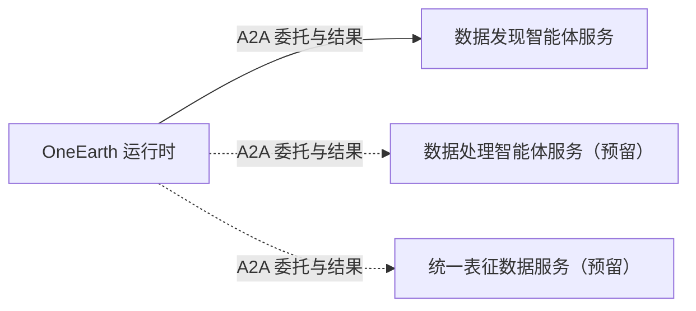
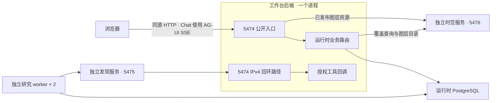

<a id="oneearth-架构与接口审查"></a>

# OneEarth 架构与接口现状

Mac mini 运行 **v0.2.0-rc.11**。自 2026-11-28 02:27:02（上海时间），常驻 5474 的网页、运行时、两个研究 worker、发现和时空服务使用源码 `5c7de56860b970b1196bae8702e3cd9ada9ef4f3`，共用发布目录 `~/Library/Application Support/OneEarth Next/releases/v0.2.0-rc.11-5c7de56`。网页使用锁定的 Cesium 1.147.0 严格构建。研究 PDF 单次读取预算为 6 MiB，文献依据默认收起。5474 支持本机回环与指定局域网，经直连网段、Host 与同源 Origin 校验。运行时内部取证回调使用 5474 的 IPv4 回环入口。发现、时空、PostgreSQL 和对象存储分别在回环 5475、5476、55432、5900。正式 5477 无监听。[白底球正式发布](../evidence/product/ACCEPTANCE.md#mac-mini-白底球正式发布) · [Cesium 严格模式正式发布](../evidence/product/ACCEPTANCE.md#mac-mini-cesium-严格模式正式发布) · [成文保全与球体卡片正式发布](../evidence/product/ACCEPTANCE.md#mac-mini-研究成文保全与球体卡片正式发布) · [原生 AG-UI 正式发布](../evidence/product/ACCEPTANCE.md#mac-mini-原生-ag-ui-正式发布) · [Chat 与后台步骤正式发布](../evidence/product/ACCEPTANCE.md#mac-mini-chat-与后台步骤正式发布) · [断言数据集目录扩展](../evidence/product/ACCEPTANCE.md#mac-mini-ds_meta-目录扩展正式发布) · [森林时间轴静态发布](../evidence/product/ACCEPTANCE.md#mac-mini-森林时间轴静态发布) · [研究 PDF 6 MiB 发布](../evidence/product/ACCEPTANCE.md#mac-mini-研究-pdf-6-mib-正式切换)

森林与普通观测时间轴共用日期入口和弹层。森林默认显示一行时间轴，年月和日期输入在打开弹层后显示。年月定位到当月首个发布日期，手选缺测日保留所选日期并显示无数据。日期弹层与已停靠的数据速览相交时暂时收起速览，关闭后恢复原布局和位置。

数据触达主导航默认隐藏，可在设置中启用。目录提供分类浏览与已有链接，资料查找可用 Chat。案例页保留四张可视化卡。气象闪电、地震、风场和降水共用球体缩略图尺寸，桌面为 100 CSS px，窄屏为 64 CSS px。科学问题区仅有标题。森林与 C40 可从海纳数据集详情上球，降水可选年月取自本部署发布目录。Chat 通过已匹配的来源卡附加已登记的观测文件版本，可直接读取原始 NetCDF。下文保留各阶段的验收口径。[发现渠道范围上线](../evidence/product/ACCEPTANCE.md#mac-mini-发现渠道范围正式发布) · [数据触达发布](../evidence/product/ACCEPTANCE.md#mac-mini-数据触达浏览入口静态发布) · [目录架构梳理](#数据触达现行架构梳理) · [观测资料发布](../evidence/product/ACCEPTANCE.md#mac-mini-chat-观测资料入口静态发布) · [KEO 常驻切换](../evidence/product/ACCEPTANCE.md#mac-mini-日常入口的-keo-文件读取)

## 公开逻辑架构

[README 横版主图](diagrams/oneearth-public-architecture.png)展示 rc.10 形成的逻辑分工及服务规划。工作台框内包含在浏览器运行的网页界面与同源服务端入口。服务端入口提供网页并按路由转发请求，与运行时 API 由同一个工作台后端进程承载。数据处理智能体服务与统一表征数据服务并列预留，各自以 A2A 虚线连接运行时。独立工具服务以虚线标出 A2A、MCP 和 API 调用入口。

运行时 API 受理前台请求，按请求配置选择执行器。需要后台研究时，API 将任务和原请求配置写入运行时 PostgreSQL，研究 worker 从同库领取。API 和研究 worker 共用执行器适配层。

工作台通过同一个同源 HTTP 入口访问时空能力。主图用一条连线表示覆盖查询和地图图层请求。工作台后端根据路径，将覆盖查询及图层目录交给运行时业务路由，将已发布的图层资源转发给时空服务。两类响应都经同源入口返回浏览器。

### 主图连线说明

主图按职责排列服务，以实线表示现行链路，以虚线表示规划接入。单箭头指向调用目标或任务交接的下一步，普通请求的响应随原调用返回。双箭头显式表示委托与结果或请求与回执，表中列明发起方。

| 相连对象 | 线型与方向 | 用途 |
| --- | --- | --- |
| 工作台 → 运行时 API | 蓝色实线，单向 | 工作台以 AG-UI 1.0 提交 Chat 并在原连接上接收 SSE。状态、归档和目录使用各自的同源 HTTP 路由。 |
| 运行时 API → 研究 worker | 蓝色实线，单向 | API 写入 PostgreSQL，worker 从同库领取。箭头表示持久化交接。 |
| 运行时 API → 执行器适配层 | 紫色实线，单向 | API 发起前台模型调用。 |
| 研究 worker → 执行器适配层 | 紫色实线，单向 | worker 发起后台研究中的模型调用。 |
| 运行时 API → 数据发现智能体服务 | 蓝色实线，单向 | API 通过 A2A Message 查询目录和资料。 |
| 研究 worker ↔ 数据发现智能体服务 | 蓝色实线，双向 | worker 发起 A2A 研究委托，发现服务返回状态和结果。 |
| 数据发现智能体服务 ↔ 运行时 API | 紫色实线，双向 | 发现取证回调。发现服务就当前取证任务发起获授权的请求，运行时返回执行回执。 |
| 数据发现智能体服务 → 专业资料来源 | 绿色实线，单向 | 发现服务读取论文断言、海纳、STAC 等资料来源。 |
| 工作台统一入口 → 时空数据服务 | 绿色实线，单向 | 合并展示覆盖查询与地图图层请求。浏览器从同源入口发起，后端按路径路由，响应经原入口返回。 |
| 时空数据服务 → 数据发现智能体服务 | 绿色实线，单向 | 时空服务通过 A2A 主动读取发现服务的发布投影并同步本域索引。 |
| 时空数据服务 → 持久存储 | 绿色实线，单向 | 时空服务访问本域 PostGIS 和图层对象存储。 |
| OneEarth 运行时 ↔ 数据处理智能体服务 | 灰紫色虚线，双向 | 计划由运行时通过 A2A 委托处理并接收结果。 |
| OneEarth 运行时 ↔ 统一表征数据服务 | 灰紫色虚线，双向 | 计划由运行时通过 A2A 查询或获取统一表征数据，并接收来源和版本。 |
| OneEarth 运行时 → 独立工具服务 | 灰紫色虚线，单向 | 计划由运行时通过 A2A、MCP 或 API 发起工具调用。 |
| 独立工具服务 → 公开网络供应商与原站 | 橘色虚线，单向 | 计划由独立工具服务发出获批准的公开网络请求。 |

### 预留 A2A 服务



统一表征数据服务与数据发现、数据处理服务并列。启用后，运行时通过 A2A 委托查询或获取统一表征数据。服务返回可引用的数据、来源和版本信息，由运行时随原任务记录与交付。具体接口和数据格式待接入时确定。

### 独立工具服务

工具服务规划为独立于 OneEarth 运行时的服务，供运行时和其他获授权的服务或客户端调用。它执行工具并返回执行状态、结果或错误。运行时负责自身任务的业务编排和调用授权，并将回执关联到原任务。多种调用入口共用同一套工具定义、执行和权限校验。

| 调用入口 | 用途 |
| --- | --- |
| A2A | 运行时或获授权的智能体委托工具任务，接收任务状态和结果。 |
| MCP | MCP 客户端列出并调用其获授权的工具。 |
| API | 程序直接提交工具请求并读取结果或执行状态。 |

主图的橘色虚线表示独立工具服务启用后访问公开网络供应商与原站的路径。rc.10 的公开搜索、网页读取及 PDF 读取由运行时内的工具执行队列与适配层提供。首批工具和各协议的具体接口待接入时确定。

## 现行进程拓扑



上图为当前源码的启动拓扑，常驻发布版本见页首。5474 在工作台后端直接处理 Chat、任务、目录、结果和覆盖等路由。发现服务使用同端口的 IPv4 回环路径调用获准的网页工具。局域网及普通浏览器请求该路径得到 404。运行时、研究 worker、发现和时空的监督由独立 LaunchAgent 承担，使用同一个发布包。旧 5477 监听从新启动拓扑移除。[工作台入口](../server/index.ts) · [运行时路由与资源](../server/runtime-api-service.ts) · [部署端口](部署与恢复.md#端口)

## rc.10 图注

[横版架构实况](diagrams/oneearth-mac-mini-rc10.png)记录 rc.10 首发快照。此后启用的前台消息与研究交接见下文。公开逻辑图、目标设计和各发布快照可在[图索引](diagrams/README.md)分别查看。

- **任务提交与领取。** 现行工作台公开入口在进程内处理运行时业务，先写入运行时 PostgreSQL。普通 Chat 完成前台决定，需要研究时按原消息编号持久交接。独立 worker 从同库按事务领取可执行的研究任务或已到期的续行步骤，再写入结果和事件。首发图中运行时 API 指向 worker 的箭头表示持久化交接。[任务提交与领取实现](../server/postgres-task-store.ts)
- **研究取证与浏览预览。** 研究中的定向补读与开放查找仍经发现 A2A。发现决定读取范围，运行时适配层实际执行获准的公开读取并归档可追溯证据。浏览器显式打开来源、查看已保存依据或调用同源预览各走展示路径。将网页材料纳入研究证据须经带回执的研究取证。地图发布资源经网关转给时空服务，覆盖范围的业务查询经运行时 API 转给时空服务。[发现契约](发现服务-A2A.md#指定来源补读) · [预览路由](../server/source-preview.ts) · [网关](../server/index.ts)

<a id="原生-ag-ui-隔离候选"></a>

## 原生 AG-UI

工作台的对话协议使用原生 AG-UI 1.0。上海 C40 与森林日影像已在隔离环境用发布版本的实际帧验证成像和回执。运行时、两个研究 worker、发现及时空服务按[现行进程拓扑](#现行进程拓扑)运行。[正式验收](../evidence/product/ACCEPTANCE.md#mac-mini-原生-ag-ui-正式发布) · [隔离验收](../evidence/product/ACCEPTANCE.md#mac-mini-原生-ag-ui-工作台隔离验收) · [AG-UI 1.0 HTTP 绑定](https://docs.ag-ui.com/spec/1.0/basic/transports/http-sse)

| 操作 | 原生入口 | 身份和交付 |
| --- | --- | --- |
| 提交 Chat | 同源 `POST /api/ag-ui`，请求 `RunAgentInput`，受理返回 `200 text/event-stream` | 网页用官方 `@ag-ui/client 1.0.5` 的 `HttpAgent`。`threadId`、`runId`、末条用户消息 ID 分别对应原会话、原任务、用户轮次。助手正文和终稿使用同一助手消息 ID。OneEarth 专有输入置于版本化的 `forwardedProps.oneearth`。 |
| 断流与重开 | `GET /api/tasks/:runId` 及 `GET /api/tasks/:runId/record` | 浏览器核对原任务、会话和轮次。已确认排队或执行的任务继续只读查询，取不到可验证状态时按有界等待处理。断流和刷新保留原运行。重复运行 ID 返回 `409`，客户端可以只读定位原记录。 |
| 明确停止 | `DELETE /api/tasks/:runId` | 原任务状态在持久事务内终结，完成已胜出时返回 `409`。单个本地终态闭合标准事件流。迟到的远端停止回执独立记录，随后可从原任务状态读取。执行器收到中止信号且确认直接子进程已退出后关闭本地进程管道。远端停止仍以独立回执为准。 |
| 追问及问题确认 | 原 `RUN_FINISHED` 的 `outcome.type=interrupt`，携带 `interrupts`。同线程的新 `POST /api/ag-ui` 携带 `resume` | 已存原卡的 ID 同时约束 `resume.interruptId` 与 `previousTaskId`。每张原卡最多由一轮领取。原档保留原问题和真实待答状态。 |
| 地图工具与回执 | 标准工具三帧及同轮成功终态。回执使用 `PUT /api/tasks/:runId/tool-calls/:toolCallId/receipt` | 原生工具调用以 `workspace:<runId>` 标识。只有原标准调用闭合且成功终态列出该 ID，浏览器才可经原授权、视图和发布修订检查应用。可从原档独立读取提案、已应用状态和真实渲染结果。 |

受理和终态仍由原业务任务写入。PostgreSQL 的 `runtime_agui_runs` 和 `runtime_agui_events` 保存其公开交付投影。结构化规划和执行输入留在原业务路径。只有可公开的正文经标准文本帧交付，校验后终稿沿原消息输出。若已经交付的正文前缀与校验终稿冲突，原运行产生一次 `RUN_ERROR`，已核的原材料仍在归档。研究 worker 继续从同库接手原任务，发现的内部 A2A 保留既有授权与恢复规则。[公开成文](../server/public-answer-stream.ts) · [投影持久化](../server/ag-ui-persistence.ts)

运行时从原任务的持久执行状态投影标准 `STEP_STARTED` 和 `STEP_FINISHED`。发现等待、来源读取等待、续行和业务终态沿用原运行 ID。已保存的研究动作通过标准 `STATE_SNAPSHOT` 的 `snapshot.oneearth.researchProgress` 发布。流断开或重开时，从原任务状态或归档响应的顶层 `researchProgress` 读回同一结构。原执行详情从同一归档读取。

进度结构为 `{version:1,runId,revision,actions}`。动作按稳定的 `id` 和 `order` 排序，工作台只接受同一运行的新修订。同一动作从排队或进行更新到完成、部分完成、失败、超时或本轮未查。计数只在已完成或部分完成时按动作类别提供。文献主题可附带已发布记录的 ID 与标题。工作台在同一消息的「执行过程」内按序呈现，执行中默认展开，结束后可重开。业务终态与[答复交付质量](#研究答复输入与证据降级)分别记录。[公开进度字段](../src/domain/native-agui-research-progress.ts) · [持久化投影](../server/ag-ui-persistence.ts)

选择 Codex 原有服务的 `gpt-6.1-sol` 时，适配层在原调用中请求推理摘要，从 Codex 的结构化完成事件提取公开摘要。通过过滤的完整摘要投影为配对的标准 `REASONING_*` 事件，与助手正文使用各自的消息 ID。摘要只用于本轮展示和归档。模型没有返回公开摘要时，界面显示实际执行步骤及正文。默认 DeepSeek Flash 的真实样本未提供此类摘要，原始推理文本不走该公开通道。[Codex 摘要提取](../server/codex-summary-output.ts) · [进度及摘要投影](../server/ag-ui-persistence.ts) · [AG-UI 推理事件](https://docs.ag-ui.com/spec/1.0/events/reasoning) · [DeepSeek Responses API](https://api-docs.deepseek.com/guides/responses_api/)

普通追问支持原选项和补充文字，原确认动作的选项权限继续由服务端复核。问题确认允许沿用原问题、采用建议问题或提交修改后的数据问题，原请求文字始终保留。收起卡片保留待答。有效续答或明确放弃才消费原卡。已经绑定外部发现任务且仍处于原等待水位时，续答沿用原委托身份。普通追问可以没有外部委托，运行时提出的问题确认在获准后可以启动新委托。[原问题绑定](../server/ag-ui-interrupt.ts) · [AG-UI 追问与恢复](https://docs.ag-ui.com/spec/1.0/basic/patterns/interrupt-resume)

地图的应用和成像回执由原浏览器记录，迟到的渲染结果仍可写入原回执。当前线程待答调用可经 `GET /api/ag-ui/threads/:threadId/tool-calls?anchorRunId=<原运行>` 只读列出。继续时，显式用户新轮应带 `assistant.toolCalls` 及每个原调用的标准 `role:tool` 结果。受理事务核对全部待答调用及已存事实，冻结唯一标准结果。失败具有 `error`，无法核实的结果也以明确错误交代。已固化的标准消息与后到的浏览器成像记录各自可查。结果变化时返回 `WORKSPACE_TOOL_RESULTS_REQUIRED`，该次尚未受理。读取、回执、重开档案和流断开均不会自动执行地图动作或发起模型调用。[回执绑定](../server/ag-ui-workspace.ts) · [同线程待答校验](../server/postgres-ag-ui-workspace.ts) · [AG-UI 工具调用](https://docs.ag-ui.com/spec/1.0/events/tool-calls)

旧 Chat 提交、旧事件 GET、NDJSON 和旧地图回执提交已退役。任务状态、取消、归档、已有出处、发现服务 A2A 以及图层发布路径保留原有身份。数据库新增原生公开投影和追问绑定，回退时继续保留这些数据。[发布与回退](部署与恢复.md#原生-ag-ui-发布与回退)

## 现行接口索引

| 消费者 → 提供者 | 入口及归属 |
| --- | --- |
| 工作台 → 同源后端的运行时路由 | 5474 直接挂载 `POST /api/ag-ui`、`/api/tasks/:runId` 状态与取消、`/record` 归档及原生地图工具回执。结果快照、数据触达、论文详情、海纳目录、获准观测材料及覆盖查询也在同进程接入。[运行时路由](../server/runtime-api-service.ts) · [AG-UI 入口](../server/ag-ui-workbench.ts) · [工作台请求与事件契约](工作台-AG-UI.md) |
| 运行时 API → 研究 worker | API 通过运行时 PostgreSQL 同事务交接原任务和已验证计划，worker 按任务租约领取或续行。[任务交接与恢复](运行时与执行器-接口.md#运行时-api-与研究-worker) |
| 运行时／发现服务 → 执行器适配层 | 相应进程内调用模型执行函数，运行时分别标记前台及后台调用。运行时的网页工具回调使用独立队列。[执行器入口和容量](运行时与执行器-接口.md) |
| 运行时 → 发现服务 A2A | 回环 5475 上的 `POST /message:send` 是现行委托入口。论文、论文时空投影、海纳目录和指定逐景查询返回直接 Message。开放发现和精确补读受理为 Task，从原 Task 读取、订阅或取消。旧 `/v1/discoveries` 保留兼容。[请求、回执与兼容契约](发现服务-A2A.md) |
| 发现服务 → 运行时内部工具入口 | `127.0.0.1:5474` 上的 `POST /internal/discovery-web-tool/v1` 使用原 Task、消息、调用 ID 和本轮授权。运行时执行工具并保存回执，发现决定如何采纳。[工具契约](发现服务-A2A.md#公开网络工具的运行时执行) |
| 运行时 → 时空服务 | 回环 5476 签发权威覆盖范围和修订，负责覆盖及图层索引。工作台的覆盖与图层目录请求先经运行时。已发布降水清单、瓦片及指定海纳图像由网关转给时空服务。[覆盖路由](../server/coverage-router.ts) · [时空入口](../server/spatial-service.ts) · [覆盖与分块契约](时空数据服务-接口.md) |
| 同源网关的展示能力 | 静态页面、基础网格、用户主动打开的来源预览和模型设置有各自的路径。普通 Chat 的观测材料卡匹配已保存来源，并经运行时获取已登记身份。[入口路由](../server/index.ts) · [观测材料契约](发现服务-A2A.md#普通-chat-的观测资料) |
| 持久状态与发布 | 运行时、发现、时空各持有本域 PostgreSQL 数据。论文发布在发现库，时空消费 A2A 版本化投影并存入 PostGIS。图层对象由时空使用 S3。外部论文断言库保持只读。[论文发布与时空投影](#mac-mini-论文发布与时空投影) · [备份与恢复](部署与恢复.md#备份和恢复) |

网页 Chat 的 SSE 使用 AG-UI 1.0，运行时与发现服务之间的 Task 订阅使用 A2A SSE。首问、状态读取、重开归档和读取已发布目录沿各自的授权与执行路径。

## 普通 Chat 的发问时工作台状态

本节对应 Mac mini 常驻工作台。发问时由网页从当前渲染器和工作台控件取得可见状态，冻结到同一个任务请求的可选 `context.workspaceView`。它与对话历史、同一轮的显式附件、发现任务和研究归档分开。旧客户端可以省略该字段。

| 部分 | 职责 |
| --- | --- |
| 网页工作台 | 提交有界状态，包括当前页面、真实相机、可见网格与筛选、活动图层的当前选项和可用控件、短图例或计数、当前打开的详情或依据位置。相机中心、选中网格和显式附加范围分别记录。资料正文、文件地址和整批候选留在既有路径。[快照形状](../src/domain/workspace-view-context.ts) · [网页投影](../src/domain/workspace-view-projection.ts) |
| 运行时 | 让原有本轮规划和必要的答复生成读取发问时快照。快照描述界面，调查授权仍以问题原话、访问校验、明确附件和权威范围为准。规划可以解释可见事实、澄清不明指代，或对明确操作选取已列控件的绝对目标。当前快照本身不会授予检索、读取、新引用或写入权限。发现 A2A 保持既有研究范围。[本轮规划](../server/turn-planning.ts) |
| 网页回执 | 仅在相同工作台和可用控件上应用已经授权的目标，手动切换与 Chat 共用同一控件路径。发问之后用户另改视图或选件时，保留答复并提示原操作未应用。发问前触发的同一飞行可以自然结束。重开历史记录供查看。[提交与回执处理](../src/domain/store.tsx) |

控件动作覆盖 C40 城市、森林时相、降水已发布年月及 GFS 层次与预报时效。地震、气象、CTD 与冰川前缘传当前内容和可见读数。整屏像素、任意 DOM、背景过渡帧和仪表的全部底层数据没有纳入快照。复测口径见[工作台上下文验收](../evidence/product/ACCEPTANCE.md#mac-mini-普通-chat-工作台上下文隔离验收)。

## 普通 Chat 的前台消息与研究交接

常驻 5474 使用前台消息和研究交接，支持当前发布的森林时相与按需图层。该链路最初在 7574 用 `4c2b14f` 签收，早期候选 `0a52bf4` 与该修订的观察保存在隔离验收。

普通 Chat 每次发送经同源 `POST /api/ag-ui` 提交标准运行输入。模型配置、发问时快照及显式附件放在版本化扩展中。受理返回 `200 text/event-stream`。原任务状态、取消及归档覆盖同一编号。重复运行编号返回 `409`。前台同时接收至多四笔进行中的规划，满额时返回 `429`。

- **前台决定。** 运行时 API 持久记录消息，在独立有界的执行名额中经现有适配层运行轻量规划。模型结合可见工作台、相关来源身份与服务端查到的同会话待办，判断是否解释、澄清、操作界面或交研究。前台回复、澄清和界面动作保存到 `runtime_chat_messages` 与 `runtime_chat_events`，研究 worker 无需领取这些消息。Chat 进程重启后，已受理却未交付的前台操作标记中断，用户可明确重发。
- **控件待办。** 已知具体目标且需用户先确认时，服务端将核准的控件与稳定选项保存在原消息的 `workspacePending.proposedAction`，C40 另带发布修订。确认前的消息无可应用动作。随后一轮从同会话可信记录读取原待办。用户在原确认卡明确选择 `approve` 且不带补充文本时，运行时核对原卡及答复绑定，直接沿用原提案，新增模型规划为零。执行前仍核对控件、目标和修订。选择 `decline` 时直接拒绝原提案。对象缺失的追问可以保留上下文，等用户给出具体选择。
- **研究交接。** 已验证的决定及输入在私有归档中保存，同一事务用原编号创建研究任务，并发出阶段变更事件。原 worker 读取该决定继续已有研究路径，继续核验引用、范围和工具授权。明确的观测能力请求与已绑定的研究澄清保留已有业务约束。取消在消息或研究的当前阶段生效，完成与取消按持久状态核定。
- **网页应用。** 同一会话可继续发送，消息和归档按各自轮次更新。工作台在应用控件或资料操作时再核原视图、数据对象、当前选件和发布修订。过期回执保留在对话中并提示未应用。C40 名称查证只使用同一发布目录，稳定 ID 与修订进入原有回执。收藏、研究清单、返回候选、按编号打开或对照资料可由模型选择有界操作，网页复用原控件和手动流程。显示状态、原始研究证据和读写授权各由对应服务持有。

C40 前台规划将当前控件邻项与服务端核过的发布名称分开。完整名称数组上限为 128 项和 4,096 字节，超过任一上限时明确标为不全。同一次模型决定可提交规范名称，运行时在同修订目录中查到唯一成员后才生成稳定 ID 回执。目录缺项、名称歧义和换版分别保留其核验结果。

[同源路由](../server/index.ts) · [消息处理](../server/runtime-chat-channel.ts) · [消息存储](../server/postgres-chat-messages.ts) · [研究接手](../server/runtime-worker-runner.ts)

### 前台模型与后台步骤

新浏览器默认选择官方 DeepSeek Flash 和 Codex。运行时按本轮选择和实际可用凭据执行。使用官方 Flash 时，前台模型调用直接走 Responses API。默认后台通过 Codex CLI，用本机认证转发每次实际模型调用至同款 Flash，最多一次上游请求。模型计划负责提出回答、澄清、操作或研究决定，运行时验证并在本轮预算内纠正。浏览器通过原生 AG-UI 接收执行阶段、可公开的正文和核准摘要。传输、凭据及超时按[运行时与执行器契约](运行时与执行器-接口.md)核对。

前台交研究时，在运行时 PostgreSQL 的同一事务把原消息编号用作唯一研究任务编号。交接保存原话、会话和轮次、目标与范围、已核授权及历史引用。已有 Chat 历史、结果批次、资料版本与工具回执从原存储按轮读回。旧引用沿用保存的证据层级，只有本轮确有新回执时才记为新读材料。

运行时 worker 用 PostgreSQL 条件写入领取当前步骤，租约为 15 秒，每 5 秒续租。等待发现时保存步骤及原受理身份后让出执行位。接手人核对持久检查点，按原委托读回材料。受理回执丢失时按[只读恢复契约](发现服务-A2A.md#受理回执恢复)判断是否可重送原封包。过期持有者无法写进展、材料或终态。正式运行两个研究 worker，共用同一运行时库。默认同库最多持有两个有效后台步骤租约。前台受理、运行时模型、发现进程模型和网页工具队列分别限额，见[名额、时限与恢复](运行时与执行器-接口.md#名额和时限)。

网页从标准步骤和原任务状态显示等待、执行、接续和终态。活跃流断开或页面刷新时，只读核对原运行状态，完成后加载同一归档。首个受理回执不明时仍按原编号查询。一次本地取消只产生一个业务终态。远端停止另记独立回执。`remoteStop.state = "confirmed"` 表示已核实原外部任务终态，实际取消或完成等结果以 `remoteState` 为准。晚到回执仅用于核对，已保存材料仍可打开。

## 普通 Chat 的轮次与结果批次

本节功能随 `4854a4e` 在 5474 正式发布。真实模型查询和追问复测保存在 8574 隔离验收。用户原话、会话编号和用户轮次编号在发送时确定。任务编号用于提交、取消、事件和归档，重连沿用原编号及原请求。网页补交发问时有界的面板可见状态、图层显隐与焦点、当前候选和相关轮次引用。镜头、筛选、显式附加和当前候选各自记录。服务端从同会话的持久记录核对引用，跨会话和错轮次的引用不带入模型。旧档缺少可核条件时保留未知。

运行时把原轮次、原条件、实际研究状态、受托回执及结果批次放进前台规划；需要后台研究时随已验证的决定持久交接，并供答复生成使用。检索结果批次拥有自己的编号，关联产生它的任务、用户轮次、查询、条件和渠道回执。旧批次和当前筛选可以同时存在，改动筛选不能把旧候选变成新检索结果。目录命中、已读原文和工作台操作的证据级别各自沿原路径核验。

工作台操作在原归档保存可执行提案。标准工具调用获准后，网页检查当前状态、控件与原目标，经 `PUT /api/tasks/:runId/tool-calls/:toolCallId/receipt` 写入实际结果。服务端核对原会话、轮次及提案，重复相同回执保持幂等，冲突返回 `409`。归档独立显示已应用状态和实际成像结果。刷新和重开只读已有操作。

模型出站在适配层审查提示和输出结构约束，去除签名参数、凭据及本机文件定位信息。实际读取仍使用原授权身份，模型返回的净化定位符只有唯一对应已知目标时才能用于核对。公开源材料和原档不因模型投影而改写。[共享契约](../src/domain/turn-context.ts) · [运行时上下文](../server/runtime-turn-context.ts) · [模型出口](../server/executor.ts) · [回执存储](../server/postgres-chat-messages.ts)

<a id="人工追问弹框隔离候选"></a>

<a id="人工追问弹框"></a>

## 人工追问

普通 Chat 的模型在缺少必要信息时给出问题，可以附两至四个简短选项。选项不合适时只给问题。回复结果在原消息保存 `clarificationPrompt`，其中 `kind` 为 `chat`、`confirmation` 或 `research`。当轮可以在 Chat 底部展开答题卡，原消息有重新打开的入口。运行期间的机器等待和错误沿用进度或状态反馈。

浏览器在明确提交后向 `POST /api/ag-ui` 发送同会话的新运行和标准 `resume`。原运行 ID 即追问身份。运行时从原归档查选项和问题，复核规范化答复、会话及绑定。在新消息受理事务中锁定原卡的唯一续答。争抢和重复提交返回冲突，浏览器以原卡的已存续答关系只读定位胜出轮次。必要时以新运行编号交后台研究。

具体控件提案只有提交原问题的「确认执行」后才可应用。模型首轮提出操作，运行时保存目标和当时选件。答复时沿用同一目标并核对当前界面、控件、选件和适用的发布修订。拒绝或补充条件不执行旧提案，网页在应用回执前再核当下状态。已绑定研究仍按原发现委托和已保存水位继续。原问题确认卡和旧研究文本回复继续可用。[网页追问卡](../src/components/ClarificationCard.tsx) · [消息受理](../server/runtime-chat-channel.ts) · [人工澄清归档与续接](../server/clarification-guard.ts)

常驻 5474 的追问卡嵌在 Chat 底部输入区，沿用本节的单决定协议。题目和「回复此问题」留在原消息；卡片打开时可以选项、自填，或为选项补充说明。选中、关闭、Escape 和稍后回答都不提交。关闭后恢复普通输入及其草稿，未提交的答复按会话与原问题保存在本机。并行消息或机器等待不接管当前答题卡。明确提交仍走同一个消息接口及原问题绑定，工作台确认、研究续接和历史回看的条件沿用本节协议。[正式验收](../evidence/product/ACCEPTANCE.md#mac-mini-chat-追问卡正式发布) · [隔离验收](../evidence/product/ACCEPTANCE.md#mac-mini-chat-追问卡隔离验收)

### 前台 Chat 的同会话历史

普通 Chat 在当前消息受理后，从运行时 PostgreSQL 按会话和首次受理事件序号读取原用户问题及归档答复。前台转研究的一条消息保留同一任务身份，旧任务也按原顺序排入。当前消息、较后受理消息及其他会话不进入历史。浏览器仍描述发问时的视图、当前筛选和引用关系。工作台回执、结果批次和已核取证状态沿原数据路径进入决策。

历史区按 8,000 估算 tokens 控制，计入问答原块、旧轮索引、语义摘要、出处、回读结果和 JSON 结构。既有工作台、执行回执、批次及目标身份各用原有投影和上限。东亚文字按每字符一个估算单位，ASCII 字母数字串及空白串按每四字符向上取整，ASCII 标点按每个一个，其他 Unicode 按每两个 UTF-8 字节向上取整。同一规则用于不同模型，和供应方实收 token 数会有偏差。预算内按原轮完整送入，其他前台字段不再复制这些问答。超预算优先保留最近三个完整轮，逐段和整表取舍，明确标出缺块。较早轮优先保留原任务、轮次、出处和覆盖边界。超预算时只对确实送入的早轮原块取得一次限时语义摘要，未提供的段块或出处仍标为未知。

需要原块时，前台模型可在本轮通过已列任务、轮次和段块标识读回同一会话的原答与出处，至多一次，再决定本轮动作。缺失、超预算或无法授权的内容按实际原因标记。原答和旧出处有各自证据边界，受保护观测轮沿独立授权路径处理。历史正文中的链接和摘要不能创建来源权限；对有真实归档依据的公开出处，沿原来源和工具校验决定是否另行读取。单条任务的对外归档记录新历史区的任务身份、段块覆盖、哈希及预算。整段历史正文保留在各自原轮归档，后台需要时沿服务器私有交接使用。后台研究成文沿用[现行成文预算](#研究答复输入与证据降级)。[存储](../server/postgres-conversation-history.ts) · [前台历史投影](../server/conversation-history.ts)

### 前台决定的判别联合

前台模型输出只接受一个 `decide` 分支。立即操作使用工作台分支。缺信息使用追问分支。已确定目标但需要确认时使用提案分支，该分支只保存经核验的控件目标。模型不填写待办编号、待办布尔值或批准状态。

浏览器向同一 AG-UI 入口提交标准 `resume`。运行时依据实际提交和保存的同会话父运行确定是否续答。对具体提案选择「确认执行」后仍须复核原目标、工作台和发布修订。旧有档案及私有研究交接继续使用已有归属校验。原研究人工澄清按同一发现 Task 和已保存水位继续。[模型决定与验证](../server/foreground-decision.ts) · [原追问绑定](../server/ag-ui-interrupt.ts)

<a id="工作台和球体动作隔离候选"></a>

## 严格 Cesium 工作台

采用 `VITE_ONEEARTH_CESIUM_STRICT=1` 构建时，浏览器地图只创建 Cesium 画布。构建固定 Cesium 1.147.0，内置 Worker、纹理和第三方资源通过同源路径提供。默认球体使用浅白色和细海岸线。Cesium 缺省底图影像和品牌标志从默认球体移除，已发布的数据图层沿用各自的署名机制。无 WebGL 时显示明确的不可用状态。受支持的球面图层、选取和时序控制通过 Cesium 应用，能力未覆盖的动作显示相应限制。已发布图层仍通过工作台同源入口向时空服务读取。

研究格范围沿原轮保存已核的格子、条件修订和覆盖摘要。运行时只从经过校验且与原轮一致的空间覆盖证据恢复范围。目录交付通过原任务和批次保存实际渲染回执，只有 renderer 确认成像才记为已绘制。Cesium 的请求式重绘由相机变化、交互、播放和数据就绪驱动。OneEarth 静置后停止逐帧请求重绘，保留 Cesium 原生场景更新。旧研究档案继续沿原任务编号只读打开。[构建及回退](部署与恢复.md#cesium-严格构建及回退) · [隔离验收](../evidence/product/ACCEPTANCE.md#mac-mini-cesium-严格模式隔离验收)

## 工作台和球体动作

工作台和球体都沿用前台 Chat 的运行时与执行器适配层。一次轻量决策读取发问时的界面和可用动作。工作台可打开收藏、研究清单、资料速览或候选对照。球体支持定位及当前图层公开的控件，包括 C40 城市、森林日期、降水时相和风场时效。界面状态说明研究者正在看什么。附件、资料读取和研究外查仍按各自授权核验。[决策与动作](../server/turn-planning.ts) · [工作台执行](../src/domain/store.tsx)

森林手动和 Chat 选择共用同一日期控件。网页传当前日期、有限邻项、条目总数及同源清单修订。运行时读取固定的内部时空清单并核对修订，从有序清单验证确切日期或解析上一、下一已发布时相。模型获得当前邻项和首尾等摘要。动作交付前再次核对修订，然后返回属于该清单的绝对日期。未发布的确切日期得到明确提示。顺序选择可跨过缺测段。浏览器手动停在没有图层的输入日期时，仍可手动修正日期。[森林目录核验](../server/workspace-forest-publication.ts) · [同源目录读取](../src/components/use-forest-layer.ts)

服务端归档记录已提出的动作。网页复核当前控件、视图和数据修订，手动改动优先；应用结果另存于实际操作浏览器的原对话活动。归档由其他浏览器打开时可查看提案。恢复旧消息不重放操作。森林切换的控件结果与影像加载状态分别显示，失败的图像可以在图层上重试。[操作回执](../src/domain/workspace-effect.ts)

常驻 5474 已启用本节的工作台和球体动作。隔离候选的场景记录见[此前隔离验收](../evidence/product/ACCEPTANCE.md#mac-mini-工作台和球体动作隔离验收)。

在隔离候选中，当前台模型返回结构合规的读取决定，但目标为空或超过三项且可以核验原权限时，运行时可给同一模型一次数量纠正。它看到实际数量、原问题、原范围及可用的确切目标键；过量时只能缩减已选集合，空列表时只能从本轮已有候选选择。合法首答不增加调用。数量纠正和旧轮查阅共用一次额外前台规划，随后按原键反绑、权限和取消规则执行。无法绑定、重复非法或试图改动作时终止这一决定。后台成文沿用[现行成文预算](#研究答复输入与证据降级)。

### 从未打开状态加载已发布图层（隔离候选）

支持新动作的网页在发问快照声明 `publishedLayerActions`。前台模型可根据原问题、结构化补答及已登记的图层能力，提出打开数据集并选择确切条目的工作台动作。当前适配 C40 城市和大兴安岭森林日期。运行时依据稳定数据集 ID 读取固定内部发布目录，核对发布修订并解析唯一城市或确切日期。发给网页的操作仅携稳定数据集、条目和发布修订。无效、缺失、歧义或过期的目标不应用。主动加载和已上球图层的控件切换各有校验，原提案批准规则不变。

网页在实际应用前从同源重验目录修订与成员，并核对当前会话、轮次和工作台。当核验通过时沿用图层栈操作，图层及所选条目一次提交，原有图层继续保留。操作回执记录已提交、已陈旧或失败，球体另显示影像加载状态。历史归档不重放操作。对话终态失败在原答复处集中展示，网络中断可凭留存的原请求编号与请求体重新连接。已终结的追问答复不能生成新编号占用同一个父问题。[隔离验收](../evidence/product/ACCEPTANCE.md#mac-mini-未上球发布数据隔离验收)

### 模型读取实际工作台状态（隔离候选）

浏览器把发问时的视图、控件、可用能力与画布观察冻结为有采集时间的快照。当前 C40 城市和森林日期分别记录稳定条目与发布修订。选择已提交、影像正在加载、影像确实在可见画布绘制、影像失败与后来被手动状态替换各有对应证据。浏览器只把符合原任务、原操作和同一条目修订的状态报告写回原消息。已记录的最终画面不会因后来切城而改写；后续发问独立采集当时的地图。刷新可读到旧回执，旧任务不会重放。

模型决定和研究合成分别取得发问时快照、同会话原问题及实际回执。原操作的目标和拒因保留各自来源。研究合成可在同一已绑定的相关操作上补读迟到回执，原问题、来源限制与发问时快照仍保持原值。已有结果批继续保留原查询、条件和渠道。较新的失败尝试独立引用原任务，由运行时校验同会话记录并给出服务端提交时间和实际终态。模型同时看到最近尝试的结果与仍可见的旧批来源，按各自提交时间理解先后。得到新批时，实际批次在当轮合成输入和归档共用同一身份。缺少实际证据的状态留为未知。

对于应用前无法核验发布目录的原图层操作，网页与运行时在当前场景仍一致时按同一原编号进行至多一次状态复核。模型收到已持久的拒因、原目标与拒绝后新采集的快照，给出原轮说明或待确认的下一步。复核没有执行图层、搜索或读取的能力。手动变更造成陈旧的提案停止，终态图层的状态不会触发重复操作。[回执契约](../src/domain/turn-context.ts) · [同轮复核](../server/workspace-recovery.ts) · [隔离验收](../evidence/product/ACCEPTANCE.md#mac-mini-工作台状态闭环隔离验收)

### 球面数据速览的上球入口

球面数据速览标题栏原有的目录跳转替换为「数据上球」。当选中的资料有可用图层或原生视图时，按钮直接打开该资料。整批无当前资料、当前资料缺少上球能力或发布目录尚无法核验时，按钮为原生禁用。已有的数据触达导航、同批列表和独立资料详情入口继续各自显示。[速览入口](../src/components/DatasetInspector.tsx)

## 海纳首批三层隔离接入

海纳 `1835839`、`1835833`、`1846104` 在隔离 8374 从资料详情与球面速览打开。两处「数据上球」均核对当前资料的同源发布清单。批次未选中资料、清单暂不可用时由原生禁用按钮表示。三个图层共用地球底栏，时间、已发布窗口、图例、取样和定位显示在该处。发布来源及范围说明进入既有数据速览。图层与窗口使用 `hainaLayer` 和 `hainaView` 恢复。火山选点可在同一浏览器刷新时恢复，独立打开链接从未选中开始。栅格取样在刷新后清除。目录上球后返回原资料，直接打开图层链接可返回普通数据分布。试点不进入案例页产品列表。正式版本见本文开头。

工作台只把三个指定 ID 的 `/visualizations/haina/<ID>/public-v1/` 只读路径交给时空服务。PostGIS 保留已登记数据实体、可用时段和范围。清单引用带内容摘要的对象，时空服务从 S3 兼容存储读取，并提供强 ETag。准备脚本根据已核源对象生成资产；发布脚本先核验全部对象，再在一个数据库事务中登记三层。相同输入重复运行保留同一对象和索引。旧版本的内容地址仍可读取。[准备](../scripts/prepare-haina-public-pilot.py) · [隔离发布](../scripts/publish-haina-public-pilot.ts) · [同源验读](../scripts/accept-haina-public-layers.mjs)

- `1835839` 是安第斯区域 85 个实际火山点，地图或底栏选择器点选后在数据速览读原属性。
- `1835833` 仅为 2025 年 8 月，发布纽约及东京两窗口。窗口从同一海纳 COG 的不同范围按需准备，网页按清单请求已发布窗口及其原值。点选显示坐标、原始格值或窗外提示。单位和晴空观测次数仍待验证。
- `1846104` 为 2025 年 4 月的哈尔滨 `patch_000186`，索引和源栅格一致。由 64×64 向量网格生成透明 PCA 图层，只表示本图斑本期数据。点选显示坐标和已发布图斑内外。

### 两层完整源对象接入（隔离）

隔离 8374 的 `1835833` 与 `1846104` 从数据速览沿共用地球底栏上球。`1835839` 沿既有火山点路径与速览。试点期 `public-v1` 的已有对象可读。新版预览使用以下两个单独的发布代际。

- **VIIRS `global-v1`。** 2025 年 8 月海纳原件是一个 4,753,924,147 字节的 WGS84 COG，原生 float32 网格 86,400×33,600，约 15″。地球视野请求带发布修订的经纬度瓦片，低缩放使用源内置概览，点击查询原生格值。跨经度日期变更线归入同一源经度。南北边界约 65°S 和 75°N，超覆盖显示透明。固定对数色阶用于渲染，原值仍保留，单位及晴空观测次数待核。旧纽约与东京链接可定位到当地，数据来自同一个全球层。[原件准备](../scripts/download-haina-viirs.py) · [栅格执行](../scripts/haina-viirs-raster.py)
- **玄女 `coverage-v1`。** 海纳 V5 登记归档与 424 条网格索引核对覆盖，逐条核地理参考和实际 NPY。可发布 424 个唯一图斑，每片 2025-04、06、08、09、10，合计 2,120 帧；归档未提供的其它月份为空。地图用视野筛选已发布图斑，绘制和点选共用从源 UTM 网格边界转换的足迹。外包矩形只缩小候选范围。选择图斑及月份后读取相应影像。所有帧采用同一 PCA 基和颜色范围，显示的是嵌入特征。URL 可用 `hainaView` 和 `hainaMonth` 恢复图斑与月份。[覆盖生成](../scripts/prepare-haina-xuannv-coverage.py) · [发布校验](../scripts/publish-haina-xuannv-coverage.ts)

工作台同源交给时空服务，VIIRS 从单份经摘要验证的本地缓存 COG 有界读取，并发、合并同一请求和进程缓存都有上限。服务启动由 `ONEEARTH_VIIRS_SOURCE`、`ONEEARTH_VIIRS_MANIFEST`、`ONEEARTH_VIIRS_PYTHON` 显式接入已核原件。玄女继续经 PostGIS 与 S3 兼容对象存储提供清单和帧，发布对象逐件校验后在一个数据库事务登记。读取路径绑定源修订或发布修订。[HTTP 验读](../scripts/accept-haina-global-layers.mjs)

### 地球数据图层叠加（隔离）

隔离 8374 的地球图层菜单由同一入口打开。底图单选，已添加的数据集分别用复选框控制显隐。地球保存各数据集的稳定身份、显示状态和本层选件，并以单独的操作焦点连接现有底栏、取样和速览。隐藏焦点层时转向仍可见的层，全部隐藏时清除焦点。已有资料入口再次上球时复用本层，保留其余层。菜单与已添加图层归浏览器工作台持有。[菜单](../src/components/GlobeLayerMenu.tsx) · [状态与组合链接](../src/domain/globe-dataset-layers.ts)

绘制在同一投影和画布中完成。可见的栅格按图层顺序合成，点、原始覆盖边界和观测线在栅格之上显示。浏览器仅为当前可见层使用加载结果。旧单层书签继续使用原参数，多层链接附带组合、焦点、图层选件和相机；同一浏览器还保存本地工作台状态。显示状态不改变资料权限、原始数值或时空服务发布修订。[独立资源加载](../src/components/GlobeLayerResources.tsx) · [地球绘制](../src/globe/renderer.ts)

数据层包括海纳安第斯火山、全球 VIIRS、玄女哈尔滨覆盖、大兴安岭森林与 C40，以及 IMERG 月降水、GFS 风场、格陵兰 CTD 和冰川末端。已保留的巴西河网与美国地闪历史地球链接也使用各自数据集身份。独立展示页、目录空间检索结果和尚未具备上球适配的资料维持原入口和呈现方式。现有发布对象在原路径读取，无须重新加工。正式版本见本文开头。

## C40 城市目录与按需图层

工作台从时空服务的已发布清单获取城市、稳定 ID 和图像路径。本次常驻验收对应 95 城的 `full-v1` 发布。当前图层只请求所选城市的 WebP。手动和 Chat 切换共用城市控件，`?viz=c40&city=<城市 ID>` 重开时按发布清单解析。旧书签仍可打开。

发问时，C40 快照保存显示的城市、邻项、城市总数和发布修订。工作台用同源强 ETag 标识发布修订，在可用时校验原始字节。没有可核对的修订时保留手动浏览。运行时只访问固定的内部时空清单路径，校验同一修订和条目数。前台规划可选择稳定 ID 或提交规范名称，由运行时确认唯一目标并在回执附发布修订。网页再次核对当前清单和发问时状态，再交同一控件执行。请求发生换版或无法确认精确城市时，需要刷新或补充名称。

通用工作台的控件快照仍有 36 项选项上限。C40 手动控件列出完整发布目录，运行时另从同修订的目录定向核对 Chat 所指城市。明确移动镜头和缩放仍走已有地图动作，研究附件与资料访问授权沿用原有约束。[网页清单读取](../src/components/use-c40-layer.ts) · [运行时发布核验](../server/workspace-c40-publication.ts) · [快照与动作契约](../src/domain/workspace-view-context.ts)

## 森林日期与按需图层

海纳 `1846764` 从时空服务的当前清单读取可选日期，正式发布从 2013 年 1 月 30 日至 2026 年 5 月 24 日，包含 4,791 个实际发布日期。精确 `?viz=forest&forestDate=<YYYY-MM-DD>` 深链重开时只请求当日图像，缺日期如实显示，播放时仅预取下一帧。Chat 快照按当前日期和有限的可用时相投影，控制动作与手动选择共用选件校验。原月度样本和 2023 年 358 天试点仍可按其已发布对象读取。[日期控件](../src/components/ForestTimeline.tsx) · [按需读取](../src/components/use-forest-layer.ts)

## 常驻公开网络工具的职责

开放查找、同题补查和指定网页或 PDF 补读仍委托给数据发现服务。发现规划模型决定查找内容、所选来源及材料用法。运行时核准能力与范围，经内部适配层执行 Search、Fetch、原站和 PDF 读取，并保存与原发现 Task、消息和工具调用身份绑定的回执。工具执行在运行时 API 进程的独立有界队列中推进，研究 worker 可等待原 A2A 委托。论文、海纳及逐景目录查询由发现服务原有业务路径负责。公开网络工具回调只经运行时回环接口，工作台的两个访问地址均使用现有同源任务、订阅与地图接口。[内部工具接口](发现服务-A2A.md#公开网络工具的运行时执行)

## Mac mini 论文发布与时空投影

以下机制自 rc.8 形成并沿用至 rc.10。

断言数据集的首次补齐与定时同步在只读一致性快照中，以 `public.ds_meta` 的唯一 `ds_key` 为范围。可关联的 `public.dataset_metadata` 补充已核字段。同键的多个来源保留原字段，各来源不一致的时空声明分别展示。来源含可核论文用法时显示真实关联，仅有元数据时展示保存字段和空论文列表。历史内容 ID 可独立读取，自动同步管理的是该表的当前映射。源记录撤回时只撤下其同步映射。发现 PostgreSQL 原子发布，工作台后台以完整版本更新分页索引，时空服务按代接收地图投影。刷新期间或读取失败时保留上一完整数据。数据线索按规范 DOI 去重，并在各来源筛选下保留对应记录。普通地球首页只取一条记录及目录状态，打开格内资料时按服务器返回的精确引用身份分批加载。[同步运维](部署与恢复.md#论文目录发布旧格式与回退)

| 边界 | 归属与行为 |
| --- | --- |
| 发现 PostgreSQL | 发现服务和授权导入命令写同一套发布表。完整论文版本按原内容 ID 保存，当前目录按数据集键选定版本。正式导入、撤下和晚到结果受持久发布水位约束。历史版本可按原 ID 读取。外部论文断言连接保持只读。 |
| 时空服务 → 发现 A2A | 同一个 `/message:send` 提供确定性的论文地图投影。小型 head 用于后台判断是否变化，增量分页固定一代。首次同步和断档时读完整投影。传输只含地图需要的身份、类型、空间和时段字段。失败保留上一完整代。 |
| 时空服务的 PostGIS | 完整投影发布后才可查。选格时在本地索引缩小论文候选，再沿原来的 H3/S2、时段与来源过滤判定成员。历史 ID 只在明确指定的候选范围内使用。运行时沿同一覆盖范围、修订和成员回答，历史任务按原归档打开。 |
| 应用与恢复 | 纸本 SQLite 用于一次性迁移或明确回退导出。两侧各管自己的数据库，图层仍从时空索引与 S3 取对象。原几何覆盖计算缓存可重建。新格式备份保存发现发布和时空投影所在的库。 |

[rc.8 架构图 PNG](diagrams/oneearth-mac-mini-rc8.png) · [发现投影接口](发现服务-A2A.md#论文时空投影) · [迁移与恢复](../README.md#备份和恢复) · [验收记录](../evidence/product/ACCEPTANCE.md)

<a id="研究答复输入与证据降级隔离候选"></a>

## 研究答复输入与证据降级

发现服务保留原检索词、渠道和读取回执。已取得研究区时，读页排序优先考虑同时匹配主题和地区表达的页面。排序不会授予读取权限，也不证明空间覆盖、时间完整性或变量适用性。

运行时用本轮原问题、已确认范围、渠道回执与可定位证据准备回答。超出初次合成输入目标时，保留显式来源和相关的已读片段，裁切重复背景并标示省略。保留的来源仍用各自原编号，未进入本次输入的材料不能当成模型已取得的引用。首次成文、纠正和既有受控核算在原答复预算内运行，超限不会提交完整原包重试。运行时传给执行器的每次成文提示文本默认预算和硬上限为 256 KiB（262,144 个 UTF-8 字节），覆盖首包和后续节点。显式指定更低值时，首包和后续节点共同使用该值。首次成文、引用修正和受控核算共用原有 110 秒截止时间。证据动作仍只能绑定本轮真实的读取编号。

正常成文通过校验后省略 `answerDelivery`。成文降级时，AG-UI 终稿的 `RUN_FINISHED.result.oneearth.response` 与原档 `result` 可返回 `answerDelivery: {status,reason,materials}`。`status` 为 `partial` 或 `unavailable`，`reason` 为 `timeout` 或 `incomplete`。有可核材料或已有通过校验的答复片段时可部分交付。缺少可交付内容时显示暂无依据。新降级结果最多列八条可核的同轮资料引用，使用已保存的论文用法或已读网页摘录。报告候选、未查主题与缺失项沿原检索过程展示。

任务成功保存时仍可能只交付部分内容。工作台从答复交付字段显示超时或未完成原因和已保留资料。旧档缺少该字段时，从原档的交付回执、公开进度和同轮已读资料只读推导展示，原归档及出处编号保持原样。原摘要、网页或论文片段各按自身层级呈现，年份或地域相交不代表完整覆盖。完整检索批次、原来源身份和读取状态保持可查。[运行时合成](../server/research-answer.ts) · [成文预算](../server/synthesis-context-budget.ts) · [旧档展示](../src/domain/research-delivery.ts) · [正式复验](../evidence/product/ACCEPTANCE.md#mac-mini-研究成文保全与球体卡片正式发布)

### 研究轮的供应方推理说明（隔离候选）

下文为旧传输的历史隔离记录，当前公开展示规则见[原生 AG-UI](#原生-ag-ui)。当时 `GET /api/tasks/:id/events?after=<seq>` 以 NDJSON 推送状态和答复，并增设可选的 `providerReasoning`。固定的 DeepSeek Flash／Codex CLI Responses 通道读取供应方单独返回的 `response.reasoning_text.delta` 及明确提供的摘要事件。[当时的验收](../evidence/product/ACCEPTANCE.md#mac-mini-供应方推理说明隔离复验)

执行器为原有调用创建临时回环入口。服务器锁定上游、验证本地令牌，并在最终请求中逐字核对应用提示。CLI 自动附加的本机环境、权限、技能和会话元数据从供应方请求投影移除，投影再核凭据、路径和工具声明。已核通道请求 identity 编码，原 SSE 字节继续交给 CLI。说明的采集和限量与正文传输独立，实际工具类型有单独的校验。该历史隔离候选的成文上限为 192 KiB，时限为 110 秒。前台规划和后台研究继续共用原任务，独立发现调用沿该服务自身的结果及回执路径返回。

公开说明先脱敏，再按稳定 `id` 和递增 `revision` 低频更新。每段最多 8 KiB，任务保存最近 12 段，合计最多 96 KiB。普通流支持连续分片和完整尾部，极端超限显示部分提示。浏览器按原任务续读和去重，同类连续段在同一可滚动区域。终态保存该轮展示切片，续问仍从已有问答、结果批和可核出处构造上下文。说明文本只用于原轮展示。[请求投影](../server/provider-cli-request.ts) · [流式接入](../server/provider-reasoning-relay.ts) · [任务显示档](../server/provider-reasoning.ts)

### 读取后的研究决策与重读比较（隔离候选）

定向读取得到局部材料或失败回执后，原研究轮的证据模型仍可选择回答、精确读取、补充发现或澄清。输入列出当时可用动作、目标编号、原来源范围、剩余预算及具体失败。评估使用带读取层级、时间及截断信息的有限摘录，判断某段未见与全篇未见时须保留资料边界。补充发现只走已有研究能力和原授权。当前任务还没有发现身份时，符合原范围的首次查找建立独立发现委托，保留原目标和定向读取回执。补查保留已绑定报告的身份及作用，遵守仅此来源或原渠道限制。补查结果与原先读到的材料共同进入该轮合成，未取得的材料仍留缺项。

重读同一来源时，回复按同一身份引用实际装入答复输入的新旧窗口。结构或引句错误回报字段路径、期望和收到的类型，沿原答复预算修订。图表定位或重算输入未证时，可说明缺什么并回答有据部分。若修订仍不通过，仅能保留各自完整绑定原文陈述、来源和通过全套校验的独立段落。未通过的陈述和对应引文都不纳入；不能安全拆分时沿用有据片段或证据不足回执。[证据评估](../server/research-evidence.ts) · [比较校验](../server/source-read-comparison.ts) · [合成与有限恢复](../server/scientific-answer.ts)

### 研究取证纠正与原文定位（隔离候选）

前台规划与研究取证分别按时间和实际模型调用计量。前台维持 110 秒和最多 4 次模型调用。合法读取直接执行，目标数量有误时把准确错误和原授权候选交回模型，在剩余预算内修正。历史回读仍须同会话授权，至多一次。研究取证环最多 110 秒、8 次模型决定、2 次外部取材、4 次已取得来源的文内定位，工具尝试合计最多 6 次。原计划首读单列。格式或编号错误只计模型调用，失败收据返回具体字段、已有来源或位置、实际状态与剩余额度。解释字段缺失不阻塞其他字段合规的动作。相同位置已有成功或失败回执时复用该回执。实际取消沿原轮传给模型和工具。

精确补读沿原 A2A、来源身份及网页工具授权传递位置。模型从本轮获准的 W 编号选定一个来源，一次可请求最多四个标题、章节、表、图、页或公式位置。目录条目来自实际读取的结构。HTML、符合校验的 JATS 与可提取文本的 PDF 按各自读取层回传表头和原行、相应段落、公式文本或来源锚点。未找到、只读到题注或有界内容时，如实记录位置状态和可见范围。已取得且仍获准的原来源可使用独立的文内定位额度。限时的完整字节快照只在同一研究任务、来源和格式的获准读取中复用。落地页实际声明的公开 PDF 或 XML 只作为候选线索，只有原规则已允许新增公开来源且网页渠道在范围内，才可另用外部取材额度读取。通用定位不扩大来源权限。

正式部署的研究 PDF 单次读取上限为 6 MiB。版本可核的分段读取累计首包及后续分段。无可用版本标记时，首包计入同次预算并弃用，随后只接受预算内的完整单响应。可复用的单份研究 PDF 快照最大 6 MiB，保留原任务、来源和格式隔离，总快照缓存上限为 16 MiB。浏览器预览的单响应快照上限为 4 MiB。PDF 文本定位仍按实际回执报告，图中的曲线数值没有纳入文本读取。

已回传并进入成文提示的实际原句与表格沿原出处编号交付。原始数据文件声明按实际回执核验，区分表格单元、局部谓词及明确的缺项说明。需要修订时将实际字段、经净化的短句和所缺回执交回模型。引用、结构和来源校验的可修正错误沿同一循环处理，最多三次修订。重复的草稿或相同文件声明、耗尽的预算、取消和上游失败均结束修订。原出处和证据层级照常校验。必要时只保留能独立通过校验的有据段落。该节候选沿用当时的 192 KiB 提示上限和 110 秒共享时限。现行成文预算和公开过程见[研究答复](#研究答复输入与证据降级)与[原生 AG-UI](#原生-ag-ui)。[取证决定](../server/research-evidence.ts) · [位置契约](../src/domain/source-read-locator.ts) · [原站读取](../server/origin-page.ts) · [成文](../server/research-answer.ts)

### 文献依据展开

刚收到的答复和重开的旧归档使用可逐条展开的文献依据卡。点击摘要行或用键盘展开，文献资料当前详情仅在该条展开时按原条目标识读取。历史中已保存的摘录仍可单独打开。正文中的编号继续进入对应资料，收起文献卡不会改变原参考条目及档案内容。[文献卡组件](../src/components/PaperEvidenceCard.tsx) · [正式浏览器复验](../evidence/product/ACCEPTANCE.md#mac-mini-文献依据与研究答复正式发布)

## 数据触达现行架构梳理

核对了 `db9c05a` 的目录及范围链路、Mac mini 5474 正常调用与隔离负例。前端 `7446494` 调整导航偏好与浏览入口。下列记录保留各自样本和条件，rc.10 复核可参见 [已知缺口](#已知缺口)。

### 现行链路

| 功能 | 当前入口和归属 |
| --- | --- |
| 浏览、分类、筛选、分页 | 工作台经同源 `POST /api/data-access/search` 到运行时。运行时持有可重建的 SQLite/FTS 混合投影。按查询条件、目录分组及分页读取，POST 承载范围、已选 ID 和分页体。 |
| 实体数据 | 运行时按 `holding` 分类。海纳权威记录由发现服务发布，运行时通过 A2A 目录操作读取。带文件的星座接收记录也可同时进入实体和及时类。 |
| 数据线索 | 索引里有发现服务发布的论文断言目录和随产品打包的公开资料。论文详情、证据和研究问题走同源运行时 API，再经发现服务的确定性 A2A 操作。正文原文仍以成功追加的真实读取依据为准。 |
| 详情与取证 | 工作台按 ID 取资料。论文可按精确内容 ID 取历史版本，研究档案按运行时原记录重开。纯浏览的源站或 PDF 预览由网页入口交付，研究补读走现有委托。 |
| 地图与上球 | 物化覆盖的范围、版本和切片由时空服务管理。海纳森林/C40 是已发布的派生图层，经产品入口传图像；目录收录和图层预览均不能证明本地持有原始观测。 |
| 及时数据 | 运行时拥有星座接收、观测修订和文件授权。浏览以运行时目录分页与 SSE 接收事件更新。5474 抽样时 `configured=0`，当前没有正式即时源可用于真实推送的端到端验收。 |

数据触达的浏览、筛选、详情、SSE 与地图上球无需研究模型。工作台的目录与资料业务查询经过统一运行时 API，论文和海纳的目录读取是返回 Message 的 A2A 确定性操作。已有链接、地图或研究可带入限定。用户发起自由文本找资料时使用现有 Chat。独立的显式论文名称或 DOI 查找可以检索来源并发布目录条目，浏览页失败时不会自动调用它。

降水发布清单、数值瓦片和已发布海纳图像由同源入口直接转交时空服务。它们是已验收的地图资源路径。当前目录条目、论文依据和覆盖业务仍经运行时。用户明确查看原站/文件时使用网页展示路径。

### 已复现问题和待验证边界

主程证据文件位于 `~/Library/Application Support/OneEarth Next/iterations/data-access-visibility/evidence/`，文件名随对应发现列明。

1. **可用月份与目录时间筛选分叉。** 较早的 5474 审计实查 `clues` 搜「雨带迁移」，限定 `[2010,2010]` 仍返回 `nasa:imerg-monthly`，资料时间为 `[2000,2026]`。同部署已发布目录只有 2023、2024。卡片、图层和详情已能准确显示已发布年月，旧运行时投影仍按旧含义筛选。后续应分开产品理论覆盖和部署实际可用范围。运行时协调时空和资料发布方。证据见 `data-access-live-audit.json`。
2. **目录组合跨源故障会挡住其他页签。** 运行时刷新先并行读取论文和海纳目录，再查本地投影。用真实运行时路由和受控数据源预热实体一条后，仅让论文目录失败，实体、线索、及时三个页签全部返回 503。即使有上次完整投影也未返回。后续由运行时协调发现方确定分源可用状态、时效提示和降级边界。证据见 `catalogue-failure-and-doi-audit.json`。
3. **普通地图转目录与权威网格查询分岔。** 5474 正常 Chrome 选 H3 网格再从主导航进数据触达，目录查询发送浏览器构造的 268 个候选 ID，`scope` 只有时间条件；同窗口网格覆盖请求携带权威范围 ID 和修订。已验证调用来源不同，尚未证明此次样本的成员发生偏差。若后续目录要承诺“此格内”，网页、运行时和时空方需共同定义定向范围与修订承接。证据见 `map-navigation-live-audit.json`。
4. **旧案例资料确实仍参与当前目录。** 5474 搜「PANGAEA 891368」返回 `Q19-2/pangaea:891368`；搜「79 North」同时返回旧 Q19 形式资料和新论文投影。这说明目录仍是混合来源。旧编号本身兼容现有用户资料，是否保留公开入口应逐条依据真实发布和资料等级判断。优先保留历史精确读取。证据见 `legacy-case-live-check.ndjson`。
5. **DOI 聚合存在版本歧义。** 固定输入中，同 DOI 的两个显式版本产生同一个列表分组键；列表仍保留独立 `relatedIds`。这不会改写精确引用和归档；当实际目录出现同 DOI 多版时，列表代表项、关联依据和计数可能混在一起。本轮未确认正式样本有碰撞。证据见 `catalogue-failure-and-doi-audit.json`。
6. **“持有”提示超出目录证据。** 当前海纳进入实体页签所需的 `holding` 来自目录记录，不保证实验室已收取原文件、本部署能下载、或模型获准读取。“实验室持有的数据实体”这句在只有目录元数据且没有独立文件证明时可能误导。后续按目录、派生图层、实际文件与读取授权逐项明确；不能从“公共开放”推定已读。运行时协调发现和前端。证据见 `data-access-live-audit.json`。
7. **海纳当前详情可退到旧快照。** 独立 Chrome 只拦浏览器侧海纳目录 GET 为 503。C40 的运行时列表两端仍返回同一海纳 ID，详情却由 11 月 23 日快照退到随包的 11 月 13 日快照，详情里没有明确提示。另由源码确认，重开历史研究也按 `haina:<id>` 注册目录记录，当前详情已有同 ID 时可跳过网络，后续刷新又会覆盖同一对象。历史/当前同 ID 改版尚无正式样本。由网页、运行时与发现方协调明确快照时效、对应身份和降级提示。独立 QA 证据位于 `~/Library/Application Support/OneEarth Next/iterations/data-access-visibility-independent/haina-fallback-7144/checks.json`。
8. **动态目录与时空投影的范围有限。** 时空后台同步论文；海纳覆盖仍有随包范围，星座收件也还未进入时空发布修订。新接入海纳或星座条目在列表能看到时，权威覆盖未必已索引。C40 的实际上海专用图像可读；通用分块按 2026 年 10 月快照过滤仍返回空，时空方定位为种子时段字段没有登记快照。另有代码将旧 NOAA CPC 快捷入口解析到 NASA IMERG，Chat 对上球的成功提示先于资产加载。前两项宜在接真实即时源或改通用图层入口前复测，Chat 提示与 CPC 别名需在对应入口核实表达。

首次地图审计触发了现有的结果链接自动保存。生产表中查到同一探针坐标与候选数量的两条快照 `e79c1c6f-adde-4d79-a100-5deeb109c364` 和 `bcb103ad-bfba-427c-baea-c84abb11f2bd`。复跑在浏览器拦截了结果快照 PUT，目录与覆盖请求按原路径执行。两轮均无研究提交。

相关源码包括 `src/components/DiscoverView.tsx`、`src/domain/data-access.ts`、`src/domain/store.tsx`、`server/index.ts`、`server/runtime-workbench-queries.ts`、`server/data-access.ts`、`server/runtime-paper-routes.ts` 和 `server/constellations.ts`。

## 已知缺口

以下汇总 rc.10 架构评审中尚未实现或待复验的事项。发布只读验证的层次见[实测记录](../evidence/product/ACCEPTANCE.md#mac-mini-rc10-公开网络工具与局域网正式发布)。

| 评审事项 | 当前证据及待办 |
| --- | --- |
| 项目归属与入口权限 | 局域网已限制直连网段、Host 和同源 Origin。真实用户／项目归属、共享及设置权限、HTTPS 入口仍待验证。首页设置有共享状态。第二台 Mac 的审查回报覆盖只读浏览，跨设备发问、取消和多人访问仍须独立验收。 |
| 降水年份与产品身份 | 较早「雨带迁移」查询保留原条件及 2010 命中证据。rc.10 复核在资料线索按精确 ID `nasa:imerg-monthly` 查询，不限年得 1 行，分别限定 2010、2023、2024 都得 0 行。同一发布清单的 2023、2024 各有 12 个月。索引的年份语义仍与部署可选年月分叉。旧 CPC ID 仍可能映射到 IMERG。[旧审计与查询条件](#已复现问题和待验证边界) · [图层映射](../src/domain/regional-cases.ts) |
| 地图范围、证据与版本 | 地图进目录与研究选格的范围来源不同。海纳「持有」提示和无提示快照回退、旧案例材料混入、DOI 多版聚合及动态海纳与及时数据的覆盖程度均待核对。DOI 多版歧义已在受控样本出现。[分项证据](#已复现问题和待验证边界) |
| 故障、并发和跨机 | 受控中断单个来源可连带目录多个页签。开发用多角色启动器在子进程退出时停止同组进程。正式场景由独立 LaunchAgent 监督各角色。每个研究 worker 同时处理一个领取步骤，两个 worker 可以各自执行；同库默认总上限为两个有效后台步骤租约。观测技能的执行记录存入运行时 PostgreSQL，星座推送观测收件使用本机 SQLite。多人混合负载、跨机部署和状态恢复仍需在独立环境实测。[目录刷新](../server/runtime-workbench-queries.ts) · [开发启动器](../scripts/launch.mjs) · [正式管理脚本](../scripts/macos-product-service.mjs) · [执行与容量](运行时与执行器-接口.md#名额和时限) |
| 证据交互与分发 | LAN HTTP 下的证据页复制缺少备用路径。干净目录的研究复跑仍需要逐项取得外部输入。对外交接需核分发授权、许可证、固定构建与自动测试。评审基线未见主分支工作流、项目许可证或 rc.10 发布标签。目标图中的通用 Tool／Skill 接入仍按阶段验证。[部署手册](部署与恢复.md) · [目标图索引](diagrams/README.md) |

## 历史架构与评审快照

以下各节的「当前」「常驻」和接口表以其所列快照为准。它们记录原架构如何演进，保留历史接口、依据与链接。现行行为以本页前文和[发现契约](发现服务-A2A.md)为准。

### Mac mini 隔离候选的只读观测 Skill

候选 `287b8dd` 在现有运行时任务入口接受明确的固定版本观测核对。运行时首次提交固定授权摘要，并持久化研究步骤及受托身份。发现服务在原 A2A Task 内发出结构化能力需求。两侧在等待期间让出各自的作业名额。执行器仍由运行时适配层封装，只有读文件的 C 进程打开授权版本。B 根据 C 返回的单位和非空记录边界核对要求，A 将判断与依据交回原发现 Task。研究记录保存本轮材料和至多一条精确的文件版本引用。

本例支持单执行名额让出续接，以及 A 保留普通名额、B 在同一执行上下文中请求预留的 C 进程。无预留时明确记录未启动。候选使用本地受控文件和本地进程，当时生产常驻为 rc.9。具体输入、授权与机器续接见[观测核对接口](发现服务-A2A.md#只读观测核对与机器续接)。

### Mac mini 普通 Chat 的观测资料

首验在 Mac mini 隔离候选 `441f2e3` 完成。当时常驻 5474 为 rc.9。

研究者在工作台选择获准的资料版本后，普通任务输入携带问题和可见附件身份。运行时负责冻结版本、核实权限、绑定同一会话的可信归档，以及查询和回收执行结果。发现服务已授权的规划模型决定是否提出读取需求。无关问题回到原来的通用问答。已存依据足够时，发现可在当轮规划中选择复用，运行时从原研究回引依据，文件读取次数为零。

首次读取仍走固定 A→B→C。C 打开授权的原文件，B 交付经过校验的观测读据，结果经已登记的同一 A2A Task 返回发现方。专业显式入口保留。仅经操作者明确允许供模型处理的资料可进入自然对话。见[普通 Chat 的观测资料](发现服务-A2A.md#普通-chat-的观测资料)。

#### 已登记的原始 NetCDF

SN-0107 隔离候选 `a5b7d8d` 的回验从旧研究中的 NOAA 元数据来源进入。操作者先核实同一对象的发布方入口，取得原始文件并固定摘要，再将来源网址和版本写入授权注册表。工作台在原来源旁显示可选文件，运行时从当前授权取得版本，执行子进程直接读原始 NetCDF。研究档案留存实际变量、时间坐标、缺测规则和该文件的发布来源。当时常驻 5474 为 rc.9。[文件注册及读据契约](发现服务-A2A.md#从已保存来源读取已登记的-netcdf-文件)

### Mac mini v0.2.0-rc.7 签收快照

工作台经同源入口访问运行时业务 API。打开研究记录和已保存依据，从运行时原归档读取。打开当前发表的论文记录、关联问题或论文原文依据时，运行时把稳定 ID 和操作传给发现服务，得到直接 A2A Message。研究中的指定来源补读和开放发现使用同一 A2A 入口，按受托 Task 查询和订阅进展。运行时仍负责研究目标、用户确认、引用、已得材料及恢复。

[候选架构图 PNG](diagrams/oneearth-mac-mini-rc7.png) · [发现接口与样例](发现服务-A2A.md) · [验收与复测](../evidence/product/ACCEPTANCE.md)

| 调用关系 | 归属与粒度 |
| --- | --- |
| 网页 → 同源入口 → 运行时 API | `/api/tasks`、`/api/results` 打开研究和当轮依据。浏览器中的论文列表、详情、问题与依据继续使用 `/api/paper-records`。数据触达、海纳目录、覆盖和图层索引走运行时。原站显式打开、来源展示、PDF 文件资源、图层对象及静态资源沿各自传输路径。 |
| 运行时 → 发现的 A2A `/message:send` | 论文与海纳目录，以及指定集合、坐标、时段的 Earth Search 逐景查询，确定性返回 Message。已知 ID 读取不触发推理、发现任务或扩大查询。名称/DOI 的显式论文目录搜索保留原有查找及发布行为。数据触达按发现方发布修订加载目录投影。 |
| 运行时 worker → 发现的同一 A2A 入口 | 指定网页、PDF 或论文需要新材料时委托精确补读。开放发现继续独立规划。读取失败保留能核对的实际结果和缺口，旧摘录继续从已归档版本读取。 |
| 运行时 → 时空服务 | 地图覆盖范围和图层索引由时空服务判定；worker 按同一权威范围查询。图层字节由入口转发到空间服务。 |
| 持久状态 | 运行时 PostgreSQL 持有研究任务、事件和历史材料，发现 PostgreSQL 持有受托任务和成果；运行时和入口不再打开论文发布 SQLite。发现及授权导入方写 SQLite，时空服务仍读取同一发布文件。海纳目录由发现服务同步并保存发布快照，运行时读投影或已归档材料，原始文件仍由海纳提供。图层索引与对象继续使用 PostGIS 和 S3。论文断言连接始终只读。 |

模型配置仍独立。发现模型不可用时，已发布的论文查询与指定材料读取只依赖各自数据来源。发现服务不可达时，当前查询如实失败，原研究归档仍独立可开。物理跨机拆分、机构身份和项目级权限需单独验收。

### Mac mini A2A 候选

网页仍通过同源入口提交、刷新和重开研究记录。运行时 worker 通过 A2A 1.0 送出研究目的、引用、范围和工具许可，使用发现服务返回的独立 Task ID 查询快照及订阅 SSE。运行时和发现进程各自选择模型与执行器，使用既有授权。需要研究者确认时，发现 Task 保持等待状态，确认后续行同一个受托任务；取得新缺口时可另开委托。旧 v1 接口保留兼容。当前共享论文缓存和发现结果结构见[发现服务接口与兼容用法](发现服务-A2A.md)，上一次签收的架构及图保留在下节。

### Mac mini v0.2.0-rc.5 候选实现

候选源码为 `1cde6ed`，验证源实例 5774，空数据目录恢复副本 5764。5474 是已签收的 rc.3。以下记录本轮改动并保留后文的 rc.3 基线。[当前候选架构图 PNG](diagrams/oneearth-mac-mini-rc5.png) · [验收与复测](../evidence/product/ACCEPTANCE.md)

| 边界 | 本轮行为 |
| --- | --- |
| 运行时与发现服务 | 请求通过 `/v1/discoveries` 委托，传研究目标、证据缺口、已授权的范围及稳定引用。新运行时停止发送 `initialPlan`，提供方仍接受旧客户端的合法请求，发现策略与渠道重试归提供方。响应依旧含内部计划类型。固定运行时替换发现方的实测分别核对跨轮稳定引用和同一发现任务的协议内补充。 |
| 当前论文目录 | 发现服务及配置到产品状态目录的导入命令写入当前版本。一个数据集键可以保有多个稳定内容 ID。运行时收到晚到结果时归档实际引用版本。时空服务读取共享发布状态，按实际可查询的版本集合生成覆盖修订。保存的目录和历史内容纳入一致 SQLite 快照。 |
| 网页、运行时与时空范围 | `POST /api/coverage/scopes` 登记规范化范围与修订。`POST /api/coverage/cells` 在冻结的选格请求中返回同一份权威范围摘要。运行时在提交给模型规划前应用该摘要。旧柄返回 410，无法取得可信范围时覆盖未知，已保存研究记录按原快照展示。 |
| 保存的网页依据 | 已归档回答开放当轮提供的网页摘录或摘要。另存材料保留自己的采集状态及截断标记。原址可独立打开。 |

真实浏览器测试、版本替换和同版本恢复在本机隔离环境完成。发现、运行时与时空仍共享论文 SQLite 文件。机构身份、项目权限、第二执行器等价性、真实局域网 Safari、跨主机部署及容量仍待各自环境验证。

### 已签收的 v0.2.0-rc.3 基线

2026-11-22。审查对象为 Mac mini 上运行的 `v0.2.0-rc.3`，产品源码 `2603062`，阶段签收记录 `1b35471`。本文记录实现、实测和工程判断。接口表覆盖研究任务、发现、时空数据和主要旁路。正式调用以所列版本为准。

**结论。** 保留网页、运行时、执行器适配、独立数据发现和时空数据服务的职责划分。首问和追问的关键路径已通过真实验证。优先补齐发现协议、数据所有权和部署边界。当前版本可在一台 Mac mini 独立运行；不同团队分别发布服务、分别扩容和接入新智能体的条件仍不充分。

#### 实际调用关系

本节记录 rc.3 评审。

```text
浏览器中的 React 工作台和球体
  └─ 同源网页入口 5474
      ├─ 任务、事件、研究记录 → 运行时 API 5477 → 运行时 PostgreSQL
      │                                         ↑
      │                                  后台 worker 取任务、写进展
      │                                         ↓
      │                               模型规划 + 执行器适配
      │                                 ├─ 调模型或定向读来源
      │                                 └─ HTTP 委托 → 数据发现服务 5475
      │                                                  ├─ 发现 PostgreSQL
      │                                                  └─ 论文断言、海纳目录、网络工具
      ├─ 文献资料查询 → 数据发现服务 5475
      ├─ 已接入的图层、分块、覆盖查询 → 时空数据服务 5476 → PostGIS、S3
      └─ 部分基础网格、海纳目录、观测、预览、导出、模型设置仍在入口处理
```

运行时 API 是运行时对网页的接口。worker 是同一运行时中执行慢任务的程序。模型根据目标、引用和已取得的材料选择动作，服务端保存稳定身份并校验调用范围。发现与时空服务各自提供业务能力。浏览器读取图层时经过同源入口，绕过问答队列。一次模型任务、一个 HTTP 请求和一个后台进程具有不同生命周期。[启动角色](../scripts/launch.mjs) · [请求分流](../server/index.ts) · [worker](../server/runtime-worker.ts)

#### 模块边界的判断

本节记录 rc.3 评审。

| 边界 | 已经独立的部分 | 仍会牵动其他模块的地方 |
| --- | --- | --- |
| 网页与运行时 | 网页用相对地址提交和订阅任务，不需要知道运行时的端口；运行时 API 负责校验、提交和读取，worker 负责执行 | 请求含前端领域上下文、历史、模型和工具配置。服务端还引用 `src/domain` 中的类型和可变目录。网页交互与研究任务共用较大的 `store.tsx`。调整字段时仍需前后端联查。[客户端](../src/domain/runtime-client.ts) · [输入校验](../server/runtime-input.ts) · [任务上下文](../src/domain/types.ts) |
| 运行时与发现智能体 | 独立进程、HTTP 协议、独立任务库；发现负责论文线索、渠道选择、重试和部分结果；断言库是发现内部的只读来源 | 运行时的动作规划直接嵌入发现内部的 `dataSearchSchema` 和 `dataSearchInstructions`，可传序列化的 `initialPlan`。返回事件又借用内部 `DataSearchResult`。改渠道规划可能连带改运行时的模型提示和输出格式。建议公开目标、引用、范围、确认、证据缺口和来源结果，把渠道计划留在发现服务。[动作规划](../server/turn-planning.ts) · [发现协议](../server/discovery-contract.ts) · [发现实现](../server/discovery-service.ts) |
| 运行时与执行器、工具 | 统一入口可以调模型、定向读、委托发现；验收记录有真实 Codex 调用 | Codex 和 Claude 的命令与能力分支集中在同一实现。发现服务内部也直接使用这套模型调用代码。当前委托是专用 HTTP 协议；第三方智能体、工具或 Skill 的能力声明、授权和兼容测试仍待定义。不能据此声称任意执行器、MCP 或 ACP 服务均可替换。[适配入口](../server/research-executor.ts) · [执行器实现](../server/executor.ts) |
| 发现数据与其他服务 | 运行时、发现和时空索引分别连接产品数据库。海纳保存原始实体文件；PostGIS 与 S3 保存上球所需索引和衍生产物 | 本机实查发现服务、worker、时空服务同时打开同一份论文 SQLite 缓存文件。网页入口代码也访问该路径。机器分开后，论文新增可能无法及时被追问或地图看到。让发现服务按稳定 ID 提供资料，时空服务持有上球所需的版本化副本，各自管理私有缓存。[发现缓存](../server/discovery-service.ts) · [worker 依赖](../server/runtime-worker.ts) · [时空入口](../server/spatial-service.ts) |
| 球体与时空服务 | 有图层清单、按范围和时间查分块、按对象读取、ETag 缓存；通过 PostGIS 和 S3 交付的路径已跑通 | 球体有自己的降水分块路径，部分对象规则和接入脚本仍写明两个海纳数据集编号；基础网格另由网页入口提供。问答的选格查询还使用 worker 自己的覆盖索引。建议先让一个新增实体只靠登记图层和路由就能上球，再验证问答和球体读取同一版本的覆盖结果。[图层路由](../server/spatial-service.ts) · [图层登记](../scripts/seed-spatial.ts) · [问答选格](../server/question-grid.ts) |
| 部署、权限与并发 | 五个应用进程可按角色启动，任务持久化；本机部署能恢复已完成的研究记录和图层 | 默认启动器把服务地址设为回环地址，向各角色传同一套启动环境，并在一个子进程退出时停止同组其余进程。每个任务库只允许一个活动 worker。Host/Origin 校验、数据库角色和研究项目的用户权限是三个不同边界。独立扩容、用户/项目授权和分角色凭据仍须验证。[启动器](../scripts/launch.mjs) · [任务取用与恢复](../server/postgres-task-store.ts) · [入口校验](../server/access.ts) |

**已复现的配置边界。** 网页入口的模型设置把新增 Key 写进当前进程的内存映射，模型连接测试也由入口进程执行。用虚构凭据和虚构服务地址在两个隔离进程调用相同模块，设置进程能解析该凭据，另一进程无法取得。试验没有向外部发出请求。部署时注入的既有凭据是另一条已通过的路径。若产品支持用户配置模型，设置、测试和后台执行应经同一受控凭据引用，并验证用户或项目归属。[设置路由](../server/index.ts) · [凭据作用域](../server/model-service.ts)

#### 核心接口清单

本节记录 rc.3 评审。

| 消费者 → 提供者 | 当前接口 | 数据和行为 |
| --- | --- | --- |
| 网页 → 运行时 API | `POST /api/tasks`；`GET /api/tasks/:id`；`DELETE /api/tasks/:id` | 提交体为 `{id,input}`。input 含问题、会话、轮次、上下文、历史和配置；确认可以关联之前的提议。成功提交返回 202。同一 ID 与相同序列化请求可重试，内容冲突返回 409。取消会尝试改变该任务状态。[路由](../server/task-store.ts) · [持久化](../server/postgres-task-store.ts) |
| 网页 → 运行时 API | `GET /api/tasks/:id/events?after=<seq>`；`GET /api/tasks/:id/record` | 事件是逐行 JSON（NDJSON），有序号、实际时间和任务 ID；可能含空行心跳、阶段发现、结果或错误。after 可回放游标之后的事件；中断订阅与取消后台任务含义不同。record 读取已有结果。终态错误和普通 HTTP 错误应分别处理。[实现](../server/task-store.ts) · [网页客户端](../src/domain/runtime-client.ts) |
| 网页 → 运行时 API | `PUT /api/results/:id`；`GET /api/results/:id` | 结果快照。首次创建返回 201，相同内容可重复提交，已有编号对应不同内容返回 409。[结果快照](../server/result-snapshots.ts) |
| 执行器适配 → 发现服务 | `POST /v1/discoveries`；`GET /v1/discoveries/:id`；`GET /v1/discoveries/:id/events?after=<seq>`；`DELETE /v1/discoveries/:id` | 使用独立发现任务。补充发现使用新编号并关联先前发现；提供方检查原问题与配置等约束。调用方可按游标重新订阅。路由支持取消；现有客户端中断 HTTP 读取时，未见向子发现任务发送 DELETE，跨服务取消仍须单独验收。[调用方](../server/discovery-contract.ts) · [提供方](../server/discovery-service.ts) |
| 网页 → 发现服务 | `GET /api/paper-records/:id/evidence`、`GET /api/paper-records/:id/questions` 等 | 经 5474 转发，以资料身份读取证据或关联问题。当前后端还有按 SQLite 文件直接读缓存的路径。[资料接口](../server/paper-catalog.ts) |
| 网页及查询客户端 → 时空服务 | `GET /api/spatial/layers`；`GET /api/spatial/layers/:layer/chunks`；`POST /api/coverage/scopes`、`POST /api/coverage/cells` | 分块查询使用 bbox、start、end、level，返回块清单。对象资源支持 ETag 条件请求。只读调用已验证清单查询；仓库中能定位的清单 API 消费者是验收和迁移脚本。当前球体使用自己的降水 manifest、分块路径及覆盖接口。[球体分块](../src/globe/rain-tiles.ts) · [图层](../server/spatial-service.ts) · [覆盖查询](../server/coverage-router.ts) |
| 网页 → 入口本地能力 | `/api/source-preview`、`/api/research-record`、`/api/haina/catalog`、`/api/models/*`、`/grid-data` 等 | 预览、PDF 导出、目录与模型设置等各有独立语义。维护时应明确归属，避免把 5474 上出现的所有路径都归为运行时 API。[入口路由](../server/index.ts) |

已签收源码未见独立发布的完整 OpenAPI 或等效接口规范。已有 TypeScript 类型、服务端校验、模型输出 Schema 及真实集成测试，分别保障不同环节。仍缺一份生产方和消费方都能独立验证的版本契约，特别是事件字段兼容、新旧版本共存、身份传播、取消传播和错误恢复。

#### 架构怎样验收

本节记录 rc.3 评审。

| 想验证的结论 | 最有判别力的实验 | 当前证据 |
| --- | --- | --- |
| 换发现服务无需改运行时 | 在独立测试环境仅替换提供方实现或升级其检索策略。保持调用方构建不变，验证首次发现、补充发现、部分失败、确认、取消与事件回放 | 同版本真实委托、补查、部分失败、确认、刷新已有证据；替换实现与跨版本兼容待测 |
| 服务只依赖公开接口 | 各服务使用不同可写目录和限定权限的存储身份。发现一篇新论文后，在另一进程追问并查看空间覆盖 | 本机产品在切断原型访问时已通过；产品进程之间确有共享文件，仍需分开验证 |
| 增加图层或执行器的改动局部可控 | 登记另一实体的图层，用原网页选时段和分块；用第二个已授权执行器完成同一组引用、读取、发现、取消动作 | 指定图层和 Codex 已实测；自动接入任意实体、执行器等价性待测 |
| 故障隔离、多用户权限、并发成立 | 在隔离部署停止一个非必要服务，验证其余能力；用两个项目身份访问各自资料；运行多个 worker 核对任务只领取一次、可取消、可恢复 | 已测渠道局部失败、断线回放和整组重启。单 worker 是当前明确限制；独立故障、机构身份及多 worker 待测 |

**建议的实施顺序。** 先以“数据发现服务能由另一团队单独改版”为第一项架构验收，划清运行时委托字段、发现结果和证据读取接口；同步列明各服务拥有的数据库、文件和凭据。随后用分目录、分地址部署验证边界，再推进通用图层接入和执行器替换。ECS 开放给多团队前完成项目权限、任务并发和故障隔离验证。数据治理与数据处理保留为以后能独立接入的能力，本轮无需建设。

**审查方法与范围。** 审阅了已签收源码与启动脚本，并只读访问 5474—5477 的健康接口。经 5474 和直连 5476 均取得三个图层，经 5474 和 5477 读取到同一已结束的研究任务，在 5475 查到对应的发现任务。经同源入口用范围、月份和尺度查询 IMERG，返回一个块。以文件标识核实三个在线进程使用同一论文缓存。跨版本替换、跨机部署、故障注入及并发压测列为待验证。本次审查只增加文档。[目标架构](spec/01-目标与架构.md) · [产品签收及实测记录](../evidence/product/ACCEPTANCE.md) · [部署说明](../README.md)

交接包的[目标架构图](spec/目标技术架构图.png)与目标说明配套。产品验收记录还链接到本机保存的 dev.1 阶段 PNG。阅读 rc.3 的实现以本审查的调用关系和源码为准。
